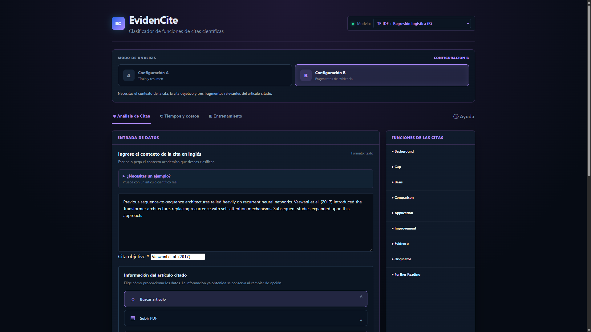
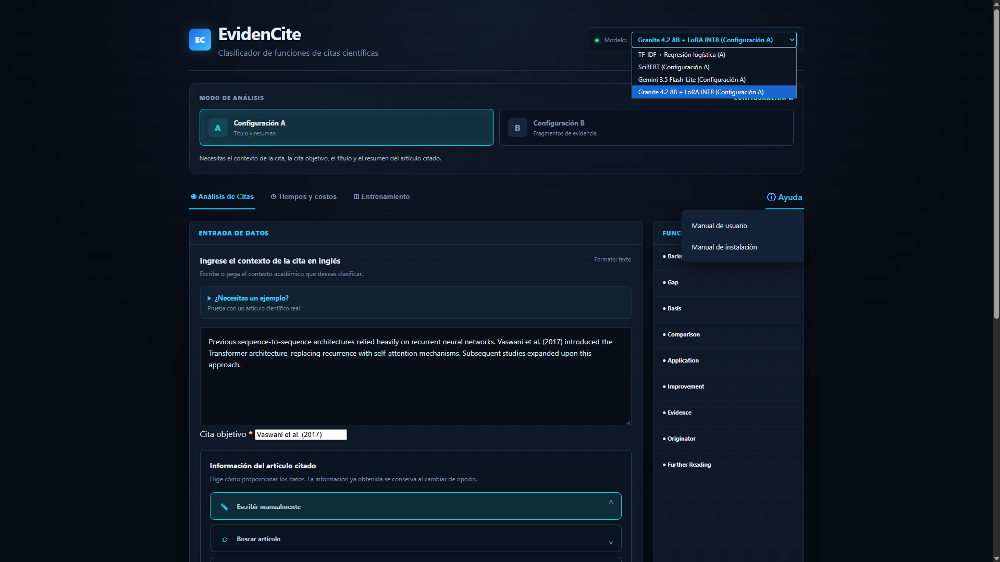
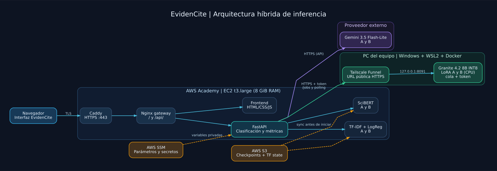
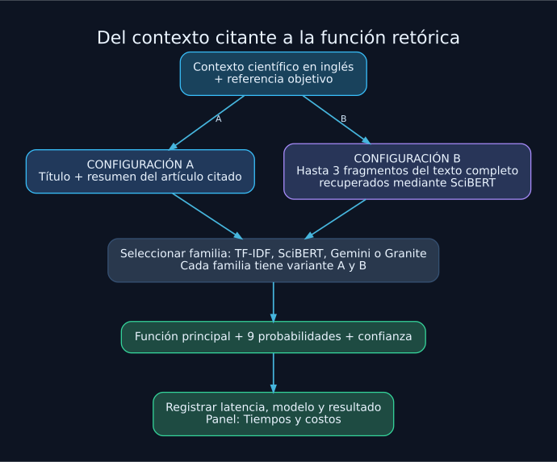
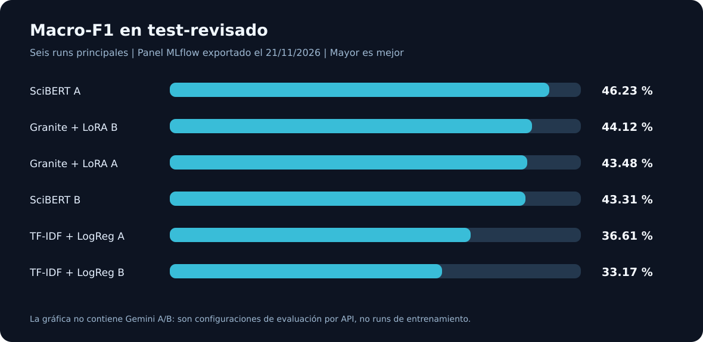
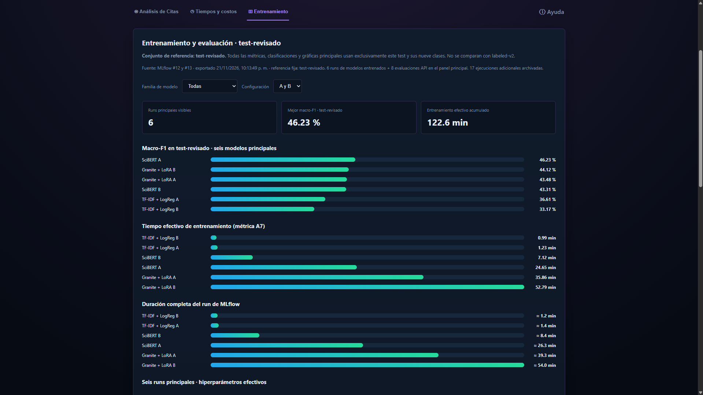
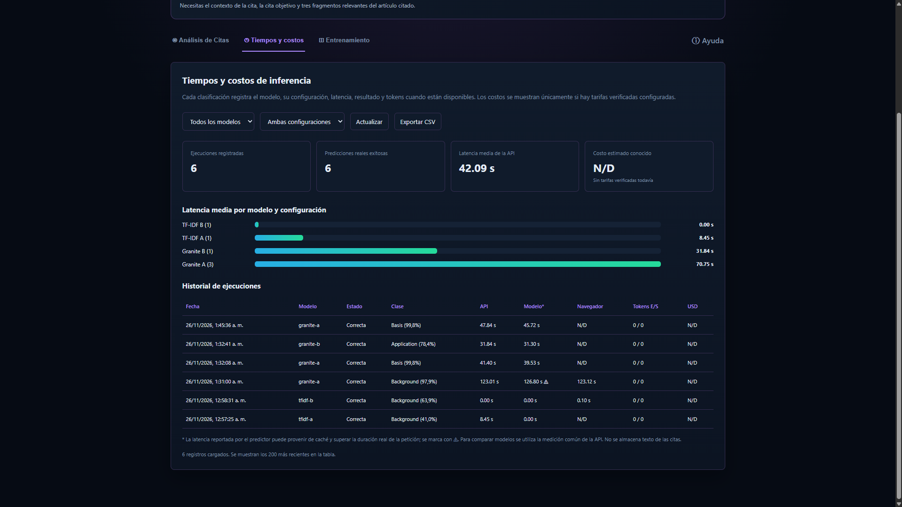

# EvidenCite

**Clasificador de funciones retóricas de citas científicas con recuperación de evidencia.** Proyecto de grado de la Maestría en Inteligencia Artificial, Universidad de los Andes.

[](pyproject.toml) [](compose.aws.yaml) [](infra/evidencite/) [](https://d-leandro.github.io/EvidenCite/)

**[Abrir aplicación](https://evidencite.34-204-10-62.sslip.io)** | **[Repositorio](https://github.com/d-leandro/EvidenCite)** | **[Manual de usuario](https://d-leandro.github.io/EvidenCite/manual-usuario.html)** | **[Manual de despliegue](https://d-leandro.github.io/EvidenCite/manual-instalacion.html)** | [English](README.md)

> **Disponibilidad de la demo.** La URL corresponde a la IP pública actual de una EC2 en AWS Academy; puede cambiar si se detiene o recrea. Los clasificadores Granite dependen además del computador del grupo y de Tailscale Funnel. Consulta `/api/v1/models` antes de una demostración. No se ofrece garantía de disponibilidad continua.

## 1. Problema y propuesta

Una cita científica no solo apunta a otro documento: puede aportar antecedentes, justificar una metodología, comparar resultados o señalar una brecha. EvidenCite recibe el **contexto citante**, identifica la **referencia objetivo** y clasifica su función retórica en nueve categorías. Permite estudiar si la evidencia discursiva del artículo citado mejora la clasificación respecto al uso de sus metadatos globales.



**Configuración A:** contexto citante + título y resumen del artículo citado. **Configuración B:** contexto citante + hasta tres fragmentos discursivos recuperados del artículo citado, con encabezados de sección cuando están disponibles. Ambas configuraciones comparten la misma taxonomía y permiten comparaciones controladas.

**Etiquetas:** Background, Gap, Basis, Comparison, Application, Improvement, Evidence, Originator y Further Reading. Las probabilidades son resultados del modelo, **no medidas de veracidad o certeza científica**.

## 2. Aplicación y guía rápida (sin instalar nada)

1. Abre la [aplicación publicada](https://evidencite.34-204-10-62.sslip.io).
2. En **Análisis de Citas**, expande **¿Necesitas un ejemplo?** y pulsa **Cargar ejemplo**. El contexto ilustrativo hace referencia a *Attention Is All You Need* (arXiv `1706.03762`).
3. Verifica la cita objetivo `Vaswani et al. (2017)`. Para A, busca y confirma el artículo (o ingresa el título y resumen manualmente). Para B, recupera los tres fragmentos o procesa el PDF correspondiente.
4. Elige uno de los modelos que aparezca disponible, pulsa **Clasificar intención de cita** e interpreta la etiqueta y las nueve probabilidades.
5. Revisa **Tiempos y costos** para latencias registradas y **Entrenamiento** para métricas de los experimentos. Los valores de la pestaña de entrenamiento corresponden al conjunto `test-revisado` y no a las predicciones individuales del navegador.

**Ejemplo de contexto (texto ilustrativo del equipo, no cita textual de un artículo):**

> Previous sequence-to-sequence architectures relied heavily on recurrent neural networks. Vaswani et al. (2017) introduced the Transformer architecture, replacing recurrence with self-attention mechanisms. Subsequent studies expanded upon this approach.



## 3. Modelos disponibles

| Familia | Configuración A | Configuración B | Ejecución en la demo |
|---|---|---|---|
| TF-IDF + regresión logística | `tfidf-a` | `tfidf-b` | Contenedor API en EC2, artefactos descargados de S3 |
| SciBERT | `scibert-a` | `scibert-b` | Contenedor API en EC2, checkpoints descargados de S3 |
| Gemini 3.5 Flash-Lite | `gemini-a` | `gemini-b` | API externa con credencial protegida en AWS Systems Manager |
| Granite 4.2 8B + LoRA INT8 | `granite-a` | `granite-b` | CPU del PC del grupo, servicio HTTPS autenticado por Tailscale Funnel |

En la sesión de verificación del **26 de noviembre de 2026**, los ocho identificadores devolvieron `available=true` y se probó inferencia real Granite A/B (`is_demo=false`). La disponibilidad es dinámica: no implica que cada servicio permanezca encendido después de la sesión.

### Arquitectura de ejecución



El navegador se comunica con **Caddy (TLS)** y **Nginx (gateway)** en una `t3.large` de AWS Academy. FastAPI atiende `/api/v1/*`; para Granite, crea trabajos en el servicio remoto, consulta su estado y registra la inferencia. El token de acceso es un secreto de SSM y no se expone al navegador. La interfaz jamás llama directamente al PC.



## 4. Organización del repositorio

| Carpeta o archivo | Contenido |
|---|---|
| `notebooks/` | Cuadernos de análisis, entrenamiento y evaluación: TF-IDF, SciBERT, LoRA, consolidación de métricas y paneles de jueces |
| `models/` | Artefactos TF-IDF incluidos si cumplen el límite de GitHub; índice de checkpoints y procedimiento de recuperación de pesos mayores |
| `data/` | Estructura de datos crudos, procesados y archivos de control DVC; los conjuntos completos requieren acceso autorizado al remoto |
| `data_example/` | Muestra pública liviana (`train`/`dev`/`test` × 3 instancias reales + `dataset_metrics.json`) y guía del ensamblaje Config A/B en *runtime* |
| `configs/` | Parámetros YAML para preparación, recuperación, clasificación, entrenamiento y evaluación |
| `src/` | Pipeline, ingeniería de datos, recuperación densa e inferencia |
| `api/` y `app/` | API FastAPI, frontend web, adaptadores de modelos, métricas y procesamiento de documentos |
| `infra/evidencite/` | Infraestructura Terraform de la EC2 del laboratorio |
| `compose.aws.yaml`, `compose.granite-local.yaml` | Servicios en AWS y trabajador Granite en el PC, respectivamente |
| `tools/`, `.github/workflows/` | Scripts de publicación, validación, despliegue y destrucción controlada |
| `docs/` | Manuales, capturas, diagramas y documentación GitHub Pages |

No se publican secretos, claves de AWS, tokens de modelos privados ni datos restringidos.

## 5. Dependencias y entornos

| Modalidad | Requisitos principales |
|---|---|
| Uso de la demo | Navegador moderno y conectividad a Internet; **sin usuario/clave** |
| Desarrollo Python | Python `>=3.11` según `pyproject.toml`, gestor `uv` y dependencias de `uv.lock`. Las imágenes de despliegue utilizan **Python 3.12** |
| Aplicación local en Docker | Docker Engine / Docker Desktop con Compose; para inferencia completa se requieren artefactos y claves privadas |
| AWS Academy | Cuenta Learner Lab, AWS CLI, Terraform 1.11, permisos EC2/SSM/S3, región `us-east-1`, perfil de instancia `LabInstanceProfile` |
| Granite local | PC con memoria suficiente, WSL2 + Docker Desktop (Windows), pesos Granite 4.2 8B y adaptadores A/B; Tailscale Funnel para acceso HTTPS externo |

Las dependencias Python están en `pyproject.toml` y `uv.lock`; las dependencias del contenedor web en `api/requirements-docker.txt` y los Dockerfiles. El entrenamiento y la inferencia tienen requisitos diferentes: **no es necesario entrenar para usar la aplicación publicada**.

### Instalación para investigación

```bash
git clone https://github.com/d-leandro/EvidenCite.git
cd EvidenCite
# Recomendado: python y uv compatibles con uv.lock
uv sync
uv run pytest tests/unit/
```

Los artefactos privados no se incluyen en este comando. Para un despliegue local completo, consulta el [manual de instalación](https://d-leandro.github.io/EvidenCite/manual-instalacion.html) y `models/README.md`.

## 6. Despliegue (visión operativa)

El despliegue **no se activa automáticamente** con un `git push`: se ejecuta con un workflow manual, después de revisar el presupuesto y las credenciales temporales de AWS Academy.

1. Autentica AWS CLI (`AWS_PROFILE=evidencite-lab`, `AWS_REGION=us-east-1`) y verifica los buckets de modelos y estado remoto.
2. Prepara los parámetros SSM `/evidencite/prod/gemini-api-key` y, para Granite, `/evidencite/prod/granite-url` y `/evidencite/prod/granite-shared-token` (SecureString).
3. Configura los secretos de GitHub Actions `AWS_ACCESS_KEY_ID`, `AWS_SECRET_ACCESS_KEY` y `AWS_SESSION_TOKEN` con credenciales vigentes del laboratorio.
4. En **Actions → Deploy EvidenCite AWS EC2**, elige la rama publicada y confirma `DEPLOY_EVIDENCITE`. El workflow ejecuta Terraform, despliega por SSM y verifica HTTPS.
5. Consulta `terraform -chdir=infra/evidencite output -raw public_url`. Para detener y eliminar recursos efímeros, usa **Destroy EvidenCite AWS EC2** con confirmación `DESTROY_EVIDENCITE` y valida primero el estado Terraform.

**Detalles completos, precondiciones, comandos y advertencias:** [Manual de instalación y despliegue](https://d-leandro.github.io/EvidenCite/manual-instalacion.html). El despliegue genera cargos contra el presupuesto del laboratorio; **no ejecutes Apply/Destroy sin comprobar el estado**.

### Variables y parametrización

| Archivo / mecanismo | Parámetros relevantes | Propósito |
|---|---|---|
| `.env.example` | `GEMINI_API_KEY`, `GOOGLE_GENAI_USE_VERTEXAI`, variables de investigación | Plantilla sin secretos reales |
| `compose.aws.yaml` | `GRANITE_URL`, `GRANITE_SHARED_TOKEN`, rutas de artefactos TF-IDF/SciBERT, límites CPU/RAM | Configura ejecución de servicios AWS |
| `compose.granite-local.yaml` | `GRANITE_BASE_DIR`, `GRANITE_A_DIR`, `GRANITE_B_DIR`, `GRANITE_SHARED_TOKEN` | Monta el modelo base y adaptadores en el PC |
| `infra/evidencite/variables.tf` | `instance_type`, `root_volume_gib`, `allow_paid_resources`, `aws_region` | Instancia, disco, región y control explícito de costos |
| `configs/*.yaml` | representación A/B, secuencia máxima 512 tokens, recuperación Top-3, parámetros de entrenamiento | Reproducibilidad experimental |
| AWS SSM Parameter Store | URL HTTPS y token Granite, credencial Gemini | Configuración y secretos remotos, sin publicarlos en Git |

**Credenciales de ejemplo:** `.env.example` contiene **nombres y valores vacíos**, no credenciales reales. Para usar la demo no se requieren credenciales; para reproducir infraestructura deben proporcionarse credenciales propias autorizadas. Nunca uses las credenciales de muestra como contraseñas reales.

## 7. Datos, modelos y reproducibilidad

- **Notebooks:** ocho notebooks versionados en `notebooks/`, incluidos los de modelos A/B y consolidación de métricas.
- **Datos:** `data/dataset.dvc` y `data/labeled.dvc` apuntan al dataset completo (`18.658` instancias, ~117 MB) gestionado con DVC/Google Drive (requiere autorización del equipo). Para inspección inmediata sin DVC ni permisos de Drive, [`data_example/`](data_example/README.md) incluye una muestra pública curada (3 instancias reales por partición —`train`, `dev` y `test`, incluyendo `inst_04783` del artículo—), las métricas auditadas completas (`data_example/dataset_metrics.json`) y el detalle ejecutable del ensamblaje en *runtime* de **Config A** vs. **Config B**.
- **Modelos:** los pequeños artefactos TF-IDF pueden incorporarse en `models/tfidf_A/` y `models/tfidf_B/` utilizando `tools/prepare_delivery_models.sh`. Los checkpoints SciBERT, los adaptadores LoRA y el Granite base se documentan en `models/README.md`; no se finge que estos archivos están incluidos en Git.

Para reconstruir el pipeline de datos (con insumos y acceso al remoto autorizados):

```bash
uv run python -m src.data.pipeline --dry-run
uv run python -m src.data.pipeline
# Evita --all --force salvo que realmente quieras reconstruir todo.
```

Para DVC se usan `config_dvc.sh` / `config_dvc.bat` y credenciales del remoto compartidas privadamente. No se recomienda publicar claves de servicio ni subir datasets indiscriminadamente.

### Evaluación experimental



Resultados del panel **Entrenamiento y evaluación**, conjunto `test-revisado`, exportado de MLflow el 21 de noviembre de 2026. Estas son métricas del experimento, no del desempeño garantizado en nuevos datos. Los seis runs principales corresponden a los modelos entrenados; Gemini A/B se evalúan por API y no forman parte de esa gráfica de entrenamiento.





## 8. API y ejemplos reproducibles

```bash
APP_URL='https://evidencite.34-204-10-62.sslip.io'
curl -fsS "$APP_URL/health"
curl -fsS "$APP_URL/api/v1/models"    # disponibilidad en tiempo real
curl -fsS "$APP_URL/api/v1/labels"
```

Ejemplo para **Configuración A** con TF-IDF, sin PDF ni cuenta externa (el contexto es ilustrativo):

```bash
curl -fsS --max-time 180 \
  "$APP_URL/api/v1/predict" \
  -H 'Content-Type: application/json' \
  --data '{
    "model_id":"tfidf-a",
    "citing_context":"Our method builds upon the Transformer architecture introduced by Vaswani et al. (2017), using self-attention instead of recurrent sequence models.",
    "target_citation":"Vaswani et al. (2017)",
    "cited_title":"Attention Is All You Need",
    "cited_abstract":"The Transformer is a neural network architecture based solely on attention mechanisms, dispensing with recurrence and convolutions."
  }'
```

El esquema de respuesta incluye `predicted_label`, `probabilities`, `confidence`, `model_name`, `configuration`, `run_id` y `server_ms` cuando la inferencia finaliza correctamente. No asumimos que un ejemplo de entrada implique una categoría de salida específica. Para B se requieren `cited_chunks` recuperados y opcionalmente `cited_chunk_sections`.

## 9. Seguridad, disponibilidad y limitaciones

- El endpoint público puede aplicar límites de tasa. No envíes cargas masivas a una infraestructura de demostración.
- Granite está en un servidor personal con URL Funnel pública, **protegida mediante un token compartido que permanece únicamente en el trabajador y en la API de AWS**. No publiques ese token ni el `.env` local.
- Los pesos grandes y datos restringidos permanecen fuera de GitHub. La recuperación exige permisos y aceptación de licencias cuando corresponda.
- La EC2 puede consumir presupuesto de AWS Academy mientras esté encendida; `destroy` elimina EC2/EBS y con ello las métricas locales, pero los artefactos persistentes de S3 se administran separadamente.
- La predicción no verifica automáticamente que el artículo citado corresponda a la referencia del contexto, ni garantiza que la etiqueta sea correcta.

## 10. Equipo y contexto académico

| Integrante | Correo institucional |
|---|---|
| Daniel Ricardo Gallo Acevedo | dr.gallo@uniandes.edu.co |
| Dubán Leandro Jiménez Puerta | dl.jimenez@uniandes.edu.co |
| Julián Andrés Malaver Montoya | ja.malaverm1@uniandes.edu.co |
| Javier Mauricio Torres Ortega | jm.torreso1@uniandes.edu.co |

**Programa:** Maestría en Inteligencia Artificial, Universidad de los Andes, Bogotá, Colombia. **Grupo de investigación:** FLAG - TICsW. **Asesor:** Juan Camilo Sanguino.

**Documentación ampliada:** [Índice](https://d-leandro.github.io/EvidenCite/) · [Manual de usuario](https://d-leandro.github.io/EvidenCite/manual-usuario.html) · [Manual de instalación](https://d-leandro.github.io/EvidenCite/manual-instalacion.html) · [Catálogo de artefactos](models/README.md).
