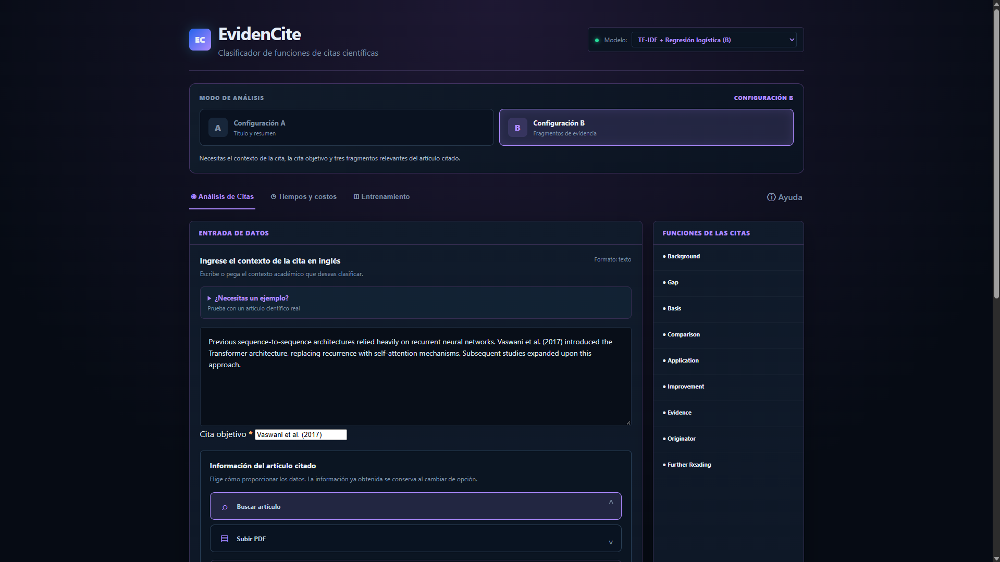
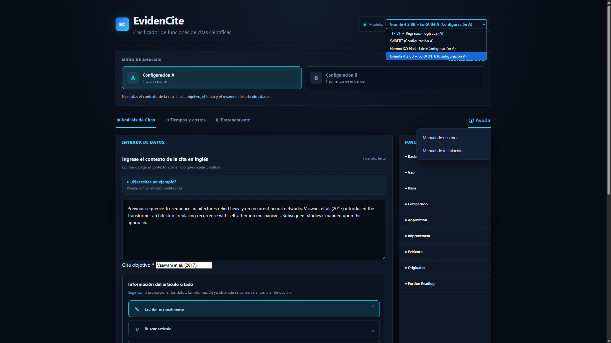
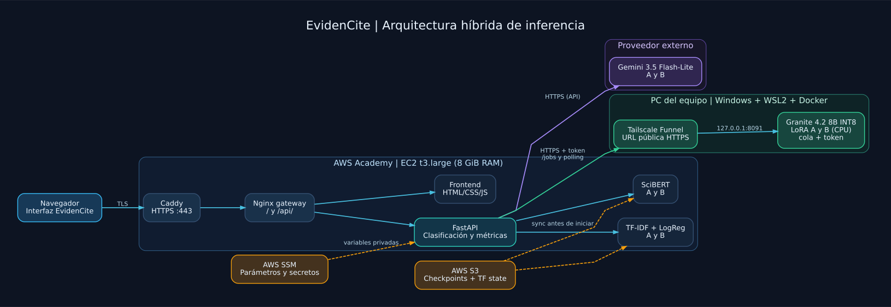
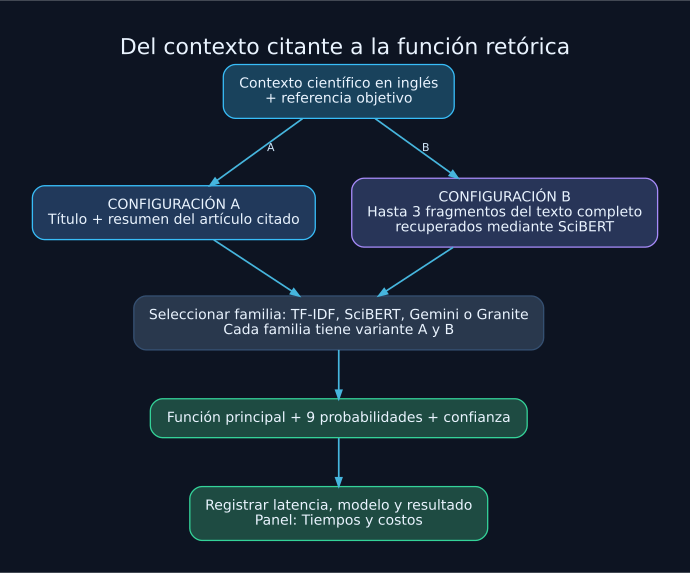
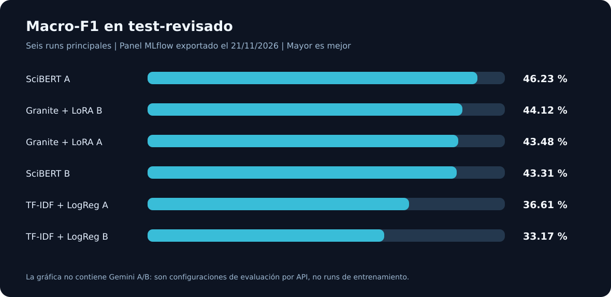
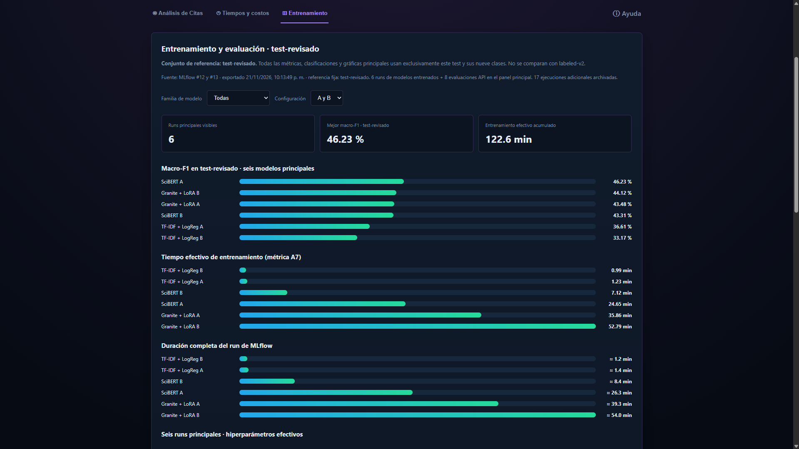
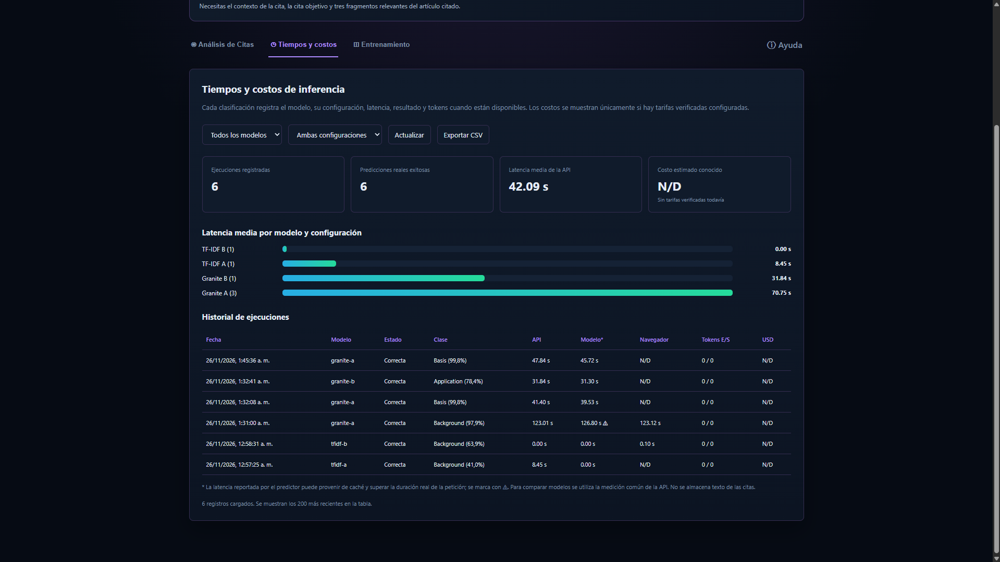

# EvidenCite

**Scientific citation rhetorical function classification with local evidence retrieval.** Master's capstone project, Universidad de los Andes, Colombia.

[](pyproject.toml) [](compose.aws.yaml) [](infra/evidencite/) [](https://d-leandro.github.io/EvidenCite/)

**[Live application](https://evidencite.34-204-10-62.sslip.io)** | **[GitHub repository](https://github.com/d-leandro/EvidenCite)** | **[User manual](https://d-leandro.github.io/EvidenCite/manual-usuario.html)** | **[Deployment manual](https://d-leandro.github.io/EvidenCite/manual-instalacion.html)** | **[Español](README.es.md)**

> **Demo availability:** this URL uses the current public address of an AWS Academy EC2 instance, which may change after stopping/recreation. Granite A/B additionally rely on the team's own PC and Tailscale Funnel. Check `GET /api/v1/models` before demonstrating. This academic prototype does not guarantee 24/7 uptime.

## 1. Problem and approach

Scientific citations fulfill different functions: introducing background, adopting a method, comparing results, identifying gaps, or supporting an argument. **EvidenCite** identifies the rhetorical function of a target reference using the citing context and information about the cited paper. The research compares two representations under controlled conditions:

- **Configuration A (global):** citing context plus the cited paper's **title and abstract**.
- **Configuration B (local):** citing context plus up to **three retrieved discursive evidence chunks** from the cited full text, optionally accompanied by section headings. The retrieval engine uses SciBERT-based dense similarity.

The nine classes are **Background, Gap, Basis, Comparison, Application, Improvement, Evidence, Originator, Further Reading**. Model probabilities are not guarantees of correctness, truthfulness, or scientific validity.



## 2. Use the deployed application (no installation needed)

1. Open the [live demo](https://evidencite.34-204-10-62.sslip.io).
2. In **Análisis de Citas**, expand **¿Necesitas un ejemplo?** and choose **Cargar ejemplo**. The example references *Attention Is All You Need* (arXiv `1706.03762`).
3. Check the target citation (`Vaswani et al. (2017)`). In mode A, search/confirm the cited document or enter its title and abstract. In mode B, retrieve the three relevant chunks or process a matching PDF.
4. Select an available model and press **Clasificar intención de cita**. Review the predicted label, confidence and all nine probabilities.
5. Explore **Tiempos y costos** for recorded inference latencies and **Entrenamiento** for experimental metrics on `test-revisado`.

The example context is team-authored illustrative material, **not a quotation from a citing paper**:

> Previous sequence-to-sequence architectures relied heavily on recurrent neural networks. Vaswani et al. (2017) introduced the Transformer architecture, replacing recurrence with self-attention mechanisms. Subsequent studies expanded upon this approach.



## 3. Model matrix

| Family | Configuration A | Configuration B | Where it runs |
|---|---|---|---|
| TF-IDF + logistic regression | `tfidf-a` | `tfidf-b` | AWS EC2 API container, checkpoints stored in S3 |
| SciBERT | `scibert-a` | `scibert-b` | AWS EC2 API container, checkpoints stored in S3 |
| Gemini 3.5 Flash-Lite | `gemini-a` | `gemini-b` | External Gemini API, access key stored in AWS Systems Manager |
| Granite 4.2 8B + LoRA INT8 | `granite-a` | `granite-b` | Team PC, CPU INT8, authenticated HTTPS via Tailscale Funnel |

As of the team's **November 26, 2026 integration test**, all eight model identifiers reported `available=true`, and real Granite A/B predictions returned `is_demo=false`. Actual availability is dynamic and depends on the running infrastructure.

### Deployed architecture



The browser communicates with Caddy TLS and an Nginx gateway on an AWS Academy `t3.large`. FastAPI serves `/api/v1/*`. Granite requests are sent **server-to-server** over a private bearer-token-protected HTTPS endpoint exposed by Tailscale Funnel; the browser is not given this token and never calls the PC directly. Long-running Granite jobs are submitted then polled, avoiding a single multi-minute tunnel request.



## 4. Repository layout

| Path | Purpose |
|---|---|
| `notebooks/` | Eight notebooks for analysis, TF-IDF, SciBERT, LoRA, metrics and judge panels |
| `models/` | Lightweight distributable TF-IDF artifacts, if size permits; catalog and retrieval instructions for larger checkpoints |
| `data/` | Raw/processed data structure and DVC pointers; access to complete datasets is controlled by the project team |
| `configs/` | YAML parameters for data processing, retrieval, A/B representation and training |
| `src/` | Reproducible data pipeline, retrieval, model training and inference |
| `api/`, `app/`, `gateway/` | FastAPI backend, web frontend and reverse proxy |
| `infra/evidencite/` | Terraform EC2 infrastructure |
| `compose.aws.yaml`, `compose.granite-local.yaml` | Production AWS services and locally hosted Granite worker |
| `tools/`, `.github/workflows/` | Build, validate, deploy and destroy scripts |
| `docs/` | GitHub Pages manuals, screenshots, charts and architecture diagrams |

## 5. Dependencies and execution environments

| Mode | Requirements |
|---|---|
| Live demo | Modern browser and Internet connectivity; **no login required** |
| Python research | Python `>=3.11` as specified in `pyproject.toml`, `uv`, and dependencies in `uv.lock` |
| Containerized API | Python **3.12**, Docker Compose, model artifacts and configured environment variables |
| AWS Academy deployment | AWS Learner Lab access, AWS CLI, Terraform 1.11, S3, SSM, `us-east-1`, `LabInstanceProfile` |
| Granite local worker | PC with sufficient RAM, Windows/WSL2 + Docker Desktop, Granite base weights and two LoRA adapters, Tailscale Funnel |

Python dependencies are defined in `pyproject.toml`, `uv.lock` and `api/requirements-docker.txt`; Dockerfiles define container runtime versions. **Training is not required to use the deployed demo.**

Research checkout:

```bash
git clone https://github.com/d-leandro/EvidenCite.git
cd EvidenCite
uv sync
uv run pytest tests/unit/
```

This does **not** install private datasets or large trained checkpoints. For a full deployment, follow the [deployment manual](https://d-leandro.github.io/EvidenCite/manual-instalacion.html) and [model artifact catalog](models/README.md).

## 6. Deployment steps and configuration

Infrastructure deployment is **manual**, not triggered by every push. **Review costs and credentials before running it.**

1. Use AWS Academy credentials in `us-east-1` (`AWS_PROFILE=evidencite-lab`) and verify the preexisting S3 model and Terraform state buckets.
2. Set AWS SSM parameters `/evidencite/prod/gemini-api-key`, and for Granite `/evidencite/prod/granite-url` and `/evidencite/prod/granite-shared-token` (the latter as `SecureString`).
3. Configure GitHub Actions secrets `AWS_ACCESS_KEY_ID`, `AWS_SECRET_ACCESS_KEY`, `AWS_SESSION_TOKEN` with currently valid Academy credentials.
4. Run **Actions → Deploy EvidenCite AWS EC2** on the reviewed branch and enter `DEPLOY_EVIDENCITE`. This uses Terraform, SSM deployment and public HTTPS checks.
5. Read the URL with `terraform -chdir=infra/evidencite output -raw public_url`. To delete ephemeral infrastructure, use **Destroy EvidenCite AWS EC2** with `DESTROY_EVIDENCITE`, after checking Terraform state and backing up metrics.

### Main parameters

| Location | Parameters | Role |
|---|---|---|
| `.env.example` | `GEMINI_API_KEY`, `GOOGLE_GENAI_USE_VERTEXAI`, research variables | Credentials template containing no valid secrets |
| `compose.aws.yaml` | `GRANITE_URL`, `GRANITE_SHARED_TOKEN`, TF-IDF/SciBERT paths, CPU/RAM limits | EC2 service configuration |
| `compose.granite-local.yaml` | `GRANITE_BASE_DIR`, `GRANITE_A_DIR`, `GRANITE_B_DIR`, `GRANITE_SHARED_TOKEN` | Local model and adapter mounts |
| `infra/evidencite/variables.tf` | `instance_type`, `root_volume_gib`, `allow_paid_resources`, `aws_region` | Infrastructure parameters and explicit cost confirmation |
| `configs/*.yaml` | A/B representation, 512-token budget, top-3 retrieval, training settings | Experimental parametrization |
| SSM Parameter Store | Granite HTTPS URL, auth token, Gemini key | Runtime secrets, never committed to Git |

**Sample credentials:** variables in `.env.example` are intentionally blank or illustrative; actual keys are required only for authorized local or infrastructure reproduction. The deployed UI requires no credentials. See the [deployment manual](https://d-leandro.github.io/EvidenCite/manual-instalacion.html) for exact commands and safety notes.

## 7. Data, model artifacts and notebooks

- `notebooks/` contains eight committed Jupyter notebooks for exploration, training and evaluation.
- `data/dataset.dvc` and `data/labeled.dvc` contain DVC pointers to data versions managed with a private Google Drive remote. The team must authorize remote access. **Which public dataset samples to publish is still pending team agreement.**
- `models/README.md` describes the artifact format and storage. Small `tfidf_pipeline.joblib` artifacts can be copied from trusted local exports or the team's private S3 bucket using `tools/prepare_delivery_models.sh`. Larger SciBERT, Granite base and LoRA files are not included in the Git repository and should not be represented as such.

Data pipeline with authorized input data:

```bash
uv run python -m src.data.pipeline --dry-run
uv run python -m src.data.pipeline
```

See `src/data/README.md` and `config_dvc.sh` / `config_dvc.bat` for DVC authorization; never commit service-account JSON keys.

### Published experimental results



The chart summarizes the six principal training runs on `test-revisado` from the MLflow-based training panel (exported November 21, 2026). Gemini A/B are API-only evaluation configurations, not extra training runs in this plot. Results are experimental, not performance guarantees on future documents.





## 8. API usage examples

```bash
APP_URL='https://evidencite.34-204-10-62.sslip.io'
curl -fsS "$APP_URL/health"
curl -fsS "$APP_URL/api/v1/models"
curl -fsS "$APP_URL/api/v1/labels"
```

Configuration A, TF-IDF (illustrative input, **no predetermined output label**):

```bash
curl -fsS --max-time 180 "$APP_URL/api/v1/predict" \
  -H 'Content-Type: application/json' \
  --data '{
    "model_id":"tfidf-a",
    "citing_context":"Our approach builds upon the Transformer architecture introduced by Vaswani et al. (2017), using self-attention rather than recurrence to process sequences.",
    "target_citation":"Vaswani et al. (2017)",
    "cited_title":"Attention Is All You Need",
    "cited_abstract":"The Transformer is an architecture based on self-attention mechanisms that dispenses with recurrence and convolution."
  }'
```

Successful API responses include `predicted_label`, `probabilities`, `confidence`, `model_name`, `configuration`, `run_id` and `server_ms`. Configuration B requires `cited_chunks`, optionally with `cited_chunk_sections`.

## 9. Known limitations and safeguards

- This is an **academic demo** with request rate limiting, dynamic AWS Academy availability and possible EC2 charges.
- The Granite service runs on the team's own computer and must remain powered on with Docker Desktop and Tailscale Funnel available. Its bearer token is only held in the local worker and AWS backend.
- Large model files and restricted data are not stored publicly. Check access rights and model licenses before any independent distribution.
- The app does not independently validate that the supplied PDF belongs to the target citation. Model output is decision support and should be critically assessed.
- Destroying the EC2 destroys its root EBS volume and the local inference metrics database. S3 model/state buckets are managed separately.

## 10. Team

| Member | Institutional email |
|---|---|
| Daniel Ricardo Gallo Acevedo | dr.gallo@uniandes.edu.co |
| Dubán Leandro Jiménez Puerta | dl.jimenez@uniandes.edu.co |
| Julián Andrés Malaver Montoya | ja.malaverm1@uniandes.edu.co |
| Javier Mauricio Torres Ortega | jm.torreso1@uniandes.edu.co |

**Program:** Master's in Artificial Intelligence, Universidad de los Andes, Bogotá, Colombia. **Research group:** FLAG - TICsW. **Advisor:** Juan Camilo Sanguino.

**Further reading:** [Documentation hub](https://d-leandro.github.io/EvidenCite/) · [User manual](https://d-leandro.github.io/EvidenCite/manual-usuario.html) · [Deployment manual](https://d-leandro.github.io/EvidenCite/manual-instalacion.html) · [Model artifact catalog](models/README.md).
