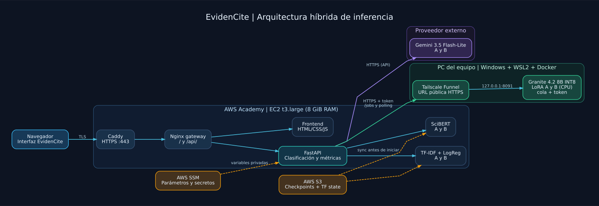
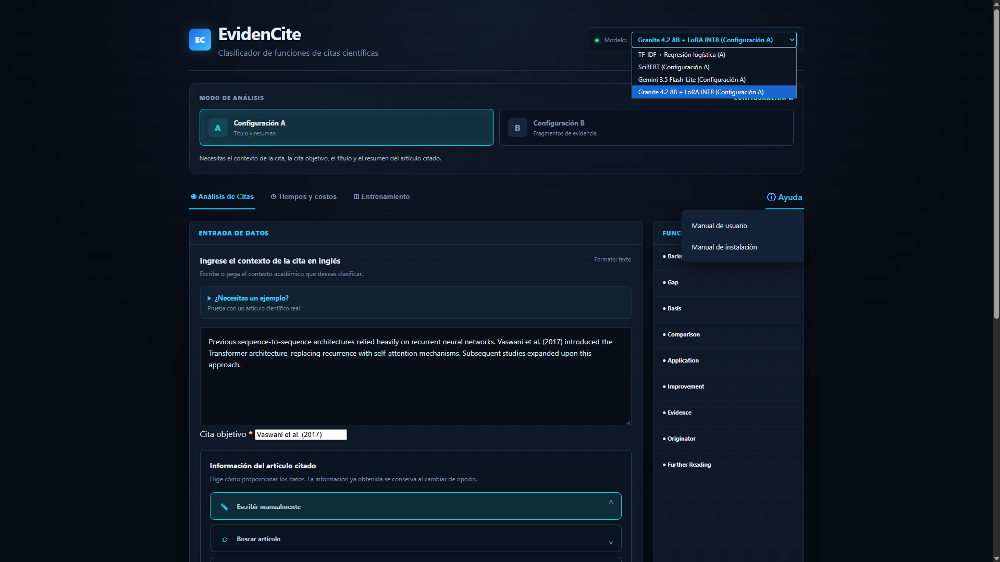
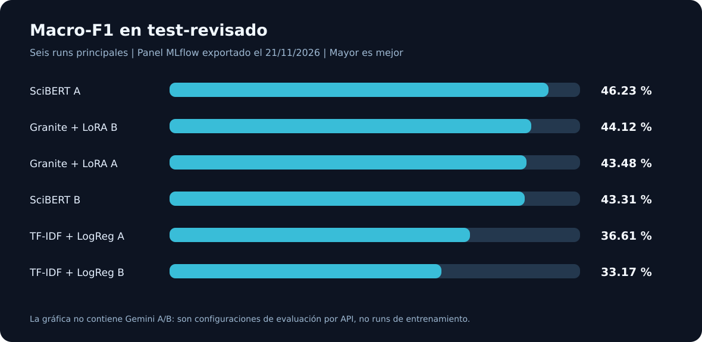

# EvidenCite: documentación de la aplicación

**Proyecto de grado MAIA, Universidad de los Andes.** EvidenCite clasifica funciones retóricas de citas científicas en nueve categorías, comparando **Configuración A** (título y resumen del artículo citado) y **Configuración B** (fragmentos de evidencia recuperados mediante SciBERT).

[**Abrir aplicación**](https://evidencite.34-204-10-62.sslip.io) | [**Repositorio GitHub**](https://github.com/d-leandro/EvidenCite) | [**README en español**](https://github.com/d-leandro/EvidenCite/blob/main/README.es.md)

> La dirección de la aplicación corresponde a la IP pública actual de AWS Academy. Puede cambiar al detener o recrear la EC2. La disponibilidad de Granite A/B depende del servicio remoto del equipo y de Tailscale Funnel.

## Manuales

- **[Manual de usuario](manual-usuario.html):** selección de modelos, ejemplo guiado, entrada de citas en modos A/B, carga de PDF, interpretaciones, capturas reales, métricas, errores frecuentes y buenas prácticas.
- **[Manual de instalación y despliegue](manual-instalacion.html):** arquitectura híbrida, variables y archivos de configuración, Docker Compose, AWS Academy, Terraform, S3, SSM, GitHub Actions, Tailscale Funnel y respaldos.
- **[Catálogo de artefactos](https://github.com/d-leandro/EvidenCite/blob/main/models/README.md):** artefactos TF-IDF y ubicación autorizada de checkpoints grandes.

## Arquitectura de la aplicación

El frontend y la API están publicados en AWS. Los clasificadores TF-IDF y SciBERT se ejecutan en EC2, Gemini utiliza la API externa y Granite 4.2 8B con adaptadores LoRA A/B se ejecuta por CPU en el computador del grupo a través de un servicio HTTPS autenticado.

## Inicio rápido

1. Abre la aplicación y expande **¿Necesitas un ejemplo?**.
2. Pulsa **Cargar ejemplo** y verifica la referencia a *Attention Is All You Need*, arXiv `1706.03762`.
3. Selecciona A o B. Para A, introduce o busca título y resumen; para B, recupera tres fragmentos del artículo.
4. Elige uno de los clasificadores disponibles y pulsa **Clasificar intención de cita**.
5. Interpreta las nueve probabilidades y, si te interesa, consulta **Tiempos y costos** o **Entrenamiento**.

El contexto del ejemplo fue redactado para ilustrar el flujo de la aplicación; no es una cita textual de otro artículo científico.

## Estado de los modelos

| Familia | Configuración A | Configuración B | Tipo de ejecución |
|---|---|---|---|
| TF-IDF + Regresión logística | Sí | Sí | AWS EC2 |
| SciBERT | Sí | Sí | AWS EC2 |
| Gemini 3.5 Flash-Lite | Sí | Sí | Servicio API externo |
| Granite 4.2 8B + LoRA INT8 | Sí | Sí | PC del equipo mediante Tailscale Funnel |

El 26 de noviembre de 2026 se verificó inferencia real en los ocho modelos. El estado operativo actual se consulta desde `GET /api/v1/models`.

## Resultados experimentales

Estos valores corresponden a los seis runs principales de los modelos entrenados, sobre el conjunto `test-revisado`; no miden la exactitud de cualquier consulta arbitraria en producción.

## Autores

Daniel Ricardo Gallo Acevedo, Dubán Leandro Jiménez Puerta, Julián Andrés Malaver Montoya y Javier Mauricio Torres Ortega. Maestría en Inteligencia Artificial, Universidad de los Andes.
