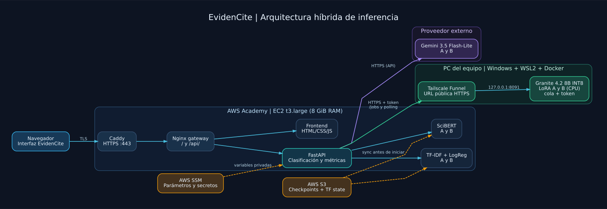
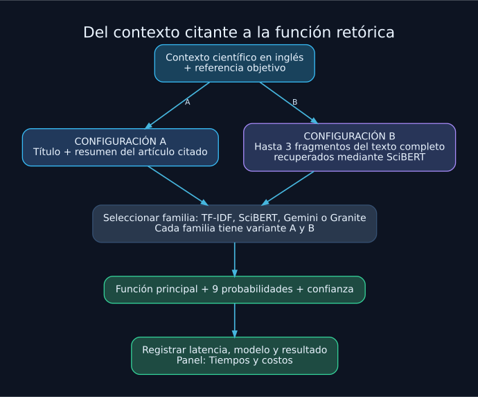
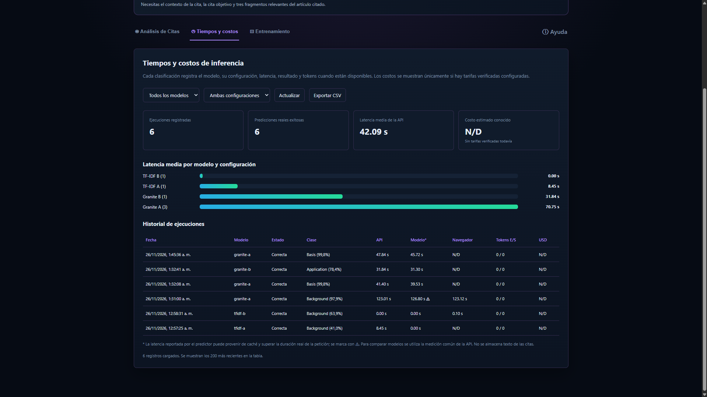

# Manual de instalación y despliegue

**EvidenCite. Infraestructura híbrida en AWS Academy y trabajador Granite en un computador del equipo.**

[Aplicación](https://evidencite.34-204-10-62.sslip.io) | [Repositorio](https://github.com/d-leandro/EvidenCite) | [Manual de usuario](manual-usuario.html)

> **Estado documentado: 26 de noviembre de 2026.** Se verificó el funcionamiento de ocho clasificadores A/B. La URL de la EC2 depende de su IP pública y puede cambiar. El laboratorio AWS Academy tiene presupuesto y permisos limitados, y el trabajador Granite depende de un computador personal; esta guía no promete disponibilidad permanente.

## 1. Arquitectura y decisiones de diseño



*Figura 1. Componentes de ejecución real y conexiones autenticadas.*

La solución se divide en dos partes:

- **AWS Academy, EC2 `t3.large` de 8 GiB:** Caddy para HTTPS público, Nginx para rutas de aplicación y API, frontend web, FastAPI, TF-IDF A/B, SciBERT A/B y el cliente de Gemini A/B.
- **PC del equipo con Windows, WSL2 y Docker Desktop:** servicio Granite 4.2 8B cuantizado INT8, con un modelo base y dos adaptadores LoRA A/B. Su FastAPI escucha en el contenedor en `8001`, publicado únicamente como `127.0.0.1:8091` en el equipo local. **Tailscale Funnel** proporciona el acceso HTTPS remoto y el servicio valida un token secreto en cada petición.

Para inferencia Granite, el navegador llama a FastAPI en AWS; FastAPI **no expone el token al navegador**, envía un trabajo a `/jobs` del servicio remoto y consulta `/jobs/{id}` hasta obtener la predicción. La cola serializa el acceso a los adaptadores para evitar competencia sobre el modelo en memoria. El mismo backend registra tiempos y resultados de todas las familias.



*Figura 2. Representaciones de entrada y despacho de modelos.*

**Por qué no ejecutar Granite en EC2:** AWS Academy permitió `t3.large` en las pruebas de permisos, pero bloqueó tamaños mayores como `t3.xlarge` o `r6i.xlarge`. Con 8 GiB de RAM no se puede alojar de manera fiable Granite INT8 junto a la aplicación. El despliegue híbrido evita contratar GPU externa; sigue consumiendo recursos locales y presupuesto AWS de EC2.

No usamos ECS, ECR ni ALB. No exponemos SSH y no abrimos el puerto 8091 a Internet mediante el router.

## 2. Requisitos y herramientas

| Componente | Requisitos |
|---|---|
| Repositorio | `https://github.com/d-leandro/EvidenCite`, rama de despliegue `feature/app-infrastructure` mientras no esté fusionada con `main` |
| AWS | AWS Academy Learner Lab con permisos EC2, SSM, S3 y cuenta autenticada en `us-east-1` |
| IaC | Terraform 1.11 o compatible, AWS CLI y buckets de estado/modelos creados previamente |
| Contenedores | Docker Engine y Docker Compose en EC2; Docker Desktop integrado con WSL2 en el PC |
| Python | `pyproject.toml` declara Python `>=3.11`; los Dockerfiles de inferencia utilizan **Python 3.12** |
| Modelos | TF-IDF y SciBERT en S3 privado; Granite base y LoRA A/B locales en el PC; credenciales de proveedor para Gemini |
| Red de Granite | Tailscale instalado en Windows con Funnel habilitado; conexión saliente a Internet |

### Archivos principales

| Archivo | Función |
|---|---|
| `infra/evidencite/*.tf` | Variables, recursos EC2/SG/volumen y outputs de Terraform |
| `infra/evidencite/bootstrap.sh` | Instalación del motor Docker en EC2 nueva |
| `compose.aws.yaml` | API, app, gateway y Caddy en la EC2 |
| `compose.granite-local.yaml` | Trabajador independiente de Granite con token, volúmenes y reinicio automático |
| `api/runtimes/granite_client.py` | Cliente HTTP de Granite remoto y consulta de trabajos |
| `api/workers/granite_service.py` | Carga de base INT8, adaptadores y cola de inferencia |
| `tools/granite_prepare_local.py` | Descubre los artefactos locales y crea archivo privado de configuración |
| `tools/granite_publish_aws.sh` | Guarda URL y token de Granite en SSM Parameter Store |
| `tools/academy_rebuild.sh` | Reutiliza o crea EC2 y solicita el despliegue por SSM |
| `tools/ec2_academy_deploy.sh` | Recupera modelos y secretos, construye contenedores y verifica seis modelos locales/externos |
| `.github/workflows/deploy.yml` | Deploy manual con confirmación de costos |
| `.github/workflows/destroy.yml` | Destroy manual con confirmación |
| `.github/workflows/validate.yml` | Validaciones de Terraform, Compose y sintaxis |

## 3. Parámetros de configuración

Las variables se agrupan por **infraestructura, runtime, modelos y entrenamiento**. Los valores secretos **no se almacenan en Git**.

### 3.1 Infraestructura AWS (Terraform)

| Variable / configuración | Ejemplo o valor actual | Descripción |
|---|---|---|
| `aws_region` | `us-east-1` | Región de EC2 y servicios auxiliares |
| `instance_type` | `t3.large` | Tipo autorizado en el laboratorio |
| `root_volume_gib` | Consultar `infra/evidencite/variables.tf` | Capacidad EBS root, condicionada por la cuota |
| `allow_paid_resources` | `true` solo al desplegar | Protección explícita contra la creación accidental de recursos facturables |
| `EVIDENCITE_DOMAIN` | `evidencite.<ip>.sslip.io` | Dominio derivado de IP pública EC2 para Caddy |
| `EVIDENCITE_MODELS_BUCKET` | `evidencite-demo-<account-id>-models` | Bucket privado de artefactos TF-IDF y SciBERT |
| Estado remoto | `evidencite/ec2-demo.tfstate` | **Clave histórica que no debe cambiarse sin migración de estado** |

No cambies `instance_type` sin verificar las políticas de AWS Academy. Una instancia ofertada por EC2 puede estar **prohibida por IAM**, aunque aparezca en el catálogo regional.

### 3.2 API y modelos (Compose y SSM)

| Nombre | Almacenamiento | Función |
|---|---|---|
| `GEMINI_API_KEY` | SSM SecureString `/evidencite/prod/gemini-api-key` | Autenticación de Gemini A/B |
| `GOOGLE_GENAI_USE_VERTEXAI` | Archivo `.env` privado en EC2 | Selección de modo de API de Google |
| `GRANITE_URL` | SSM String `/evidencite/prod/granite-url` | URL del servicio Granite remoto, p. ej. `https://<equipo>.<tailnet>.ts.net` |
| `GRANITE_SHARED_TOKEN` | SSM SecureString `/evidencite/prod/granite-shared-token` | Autorización servidor-servidor con el PC |
| `GRANITE_BASE_DIR`, `GRANITE_A_DIR`, `GRANITE_B_DIR` | `~/.config/evidencite/granite-local.env` en el PC | Directorios locales de pesos/adaptadores para montar en contenedor |
| `EVIDENCITE_TFIDF_ROOT`, `EVIDENCITE_SCIBERT_A_PATH`, `EVIDENCITE_SCIBERT_B_PATH` | `compose.aws.yaml` | Rutas de artefactos dentro del contenedor |
| `EVIDENCITE_METRICS_DB` | `compose.aws.yaml` | Base local SQLite de métricas |
| `ENABLE_DEMO_MODEL` | `false` en AWS | Evita predicciones sintéticas en la instancia de evaluación |

La configuración de ciencia de datos está en `configs/*.yaml`: representación A/B, tamaño máximo de secuencia, `top_k_chunks`, hiperparámetros de entrenamiento y rutas de datos. Consulta también `configs/model_config_a.yaml` y `configs/model_config_b.yaml`.

**Ejemplo de credenciales:** copia `.env.example` como referencia para desarrollo, deja las claves vacías hasta tener permisos propios. Nunca publiques `.env`, credenciales AWS, token de Granite, archivos de servicio de Google o artefactos con datos privados.

## 4. Preparación de la cuenta AWS

Configura AWS CLI y verifica la identidad antes de hacer cambios:

```bash
export AWS_PROFILE=evidencite-lab
export AWS_REGION=us-east-1 AWS_DEFAULT_REGION=us-east-1 AWS_PAGER=''
aws sts get-caller-identity
python3 tools/aws_academy_preflight.py
```

Recursos preexistentes requeridos:

- Bucket `evidencite-tfstate-<account-id>`: estado remoto Terraform.
- Bucket `evidencite-demo-<account-id>-models`: carpetas `tfidf_A`, `tfidf_B`, `scibert_A`, `scibert_B`; los adaptadores Granite A/B pueden permanecer como respaldo, pero no se descargan a la EC2 pequeña.
- Perfil IAM de instancia `LabInstanceProfile` con permiso para leer S3/SSM.
- Parámetro secreto `/evidencite/prod/gemini-api-key` y los dos parámetros para Granite si se desea disponer de los ocho modelos.

**No incluyas valores de secretos en Terraform, YAML comprometido o logs.** Los scripts recuperan los valores en el host EC2 y construyen un `.env` privado con permisos restrictivos.

## 5. Preparar Granite local en Windows y WSL2

### 5.1 Verificar Docker y artefactos

En el checkout de despliegue en WSL:

```bash
docker version
docker compose version
python3 tools/granite_prepare_local.py
```

El script configura un archivo **privado** `~/.config/evidencite/granite-local.env`. Busca el modelo base Granite 4.2 8B, los dos adaptadores LoRA A/B y genera o reutiliza un token largo aleatorio. Confirma que las rutas existan; **no muestres ese archivo en GitHub, screenshots ni soporte**.

No hay que volver a descargar el modelo si los pesos ya están presentes. Si faltan, revisa `models/README.md` y los permisos de acceso a la fuente original.

### 5.2 Iniciar el contenedor una sola vez

```bash
ENV_FILE="$HOME/.config/evidencite/granite-local.env"
docker compose --env-file "$ENV_FILE" \
  -f compose.granite-local.yaml up -d --build

docker compose --env-file "$ENV_FILE" \
  -f compose.granite-local.yaml logs -f granite
```

La primera construcción instala dependencias Python y puede llevar varios minutos. Una vez creada la imagen, normalmente no hace falta reconstruir para reiniciar el servicio. El log debe mostrar `GRANITE A/B LISTO`.

En una segunda terminal, comprueba disponibilidad **sin imprimir el token**:

```bash
set -a
source "$HOME/.config/evidencite/granite-local.env"
set +a
curl -fsS -H "Authorization: Bearer $GRANITE_SHARED_TOKEN" \
  http://127.0.0.1:8091/health
```

El contenedor expone únicamente el puerto local `127.0.0.1:8091`, tiene comprobación de salud y política Docker `restart: unless-stopped`.

### 5.3 Publicar HTTPS con Tailscale Funnel

En **Windows CMD con permisos de administrador** (no WSL), instala e inicia sesión en Tailscale. Antes de activar Funnel comprueba que Windows alcanza Granite:

```cmd
curl.exe -s -o NUL -w "HTTP %{http_code}" http://127.0.0.1:8091/health
```

La respuesta esperada **sin token es 401**. En CMD usa el formato estándar `HTTP %{http_code}` si se ejecuta manualmente. Usa también:

```cmd
tailscale status
tailscale funnel --bg 8091
tailscale funnel status
tailscale set --unattended=true
```

La primera habilitación de Funnel puede abrir un enlace de autorización. `funnel status` mostrará la URL HTTPS pública `*.ts.net`. **Funnel publica la ruta de Internet al servicio**, por lo que el token del worker es obligatorio. No confundas `tailscale serve` (solo tailnet) con `tailscale funnel` (Internet público).

Comprueba 401 sin token y 200 con token desde WSL:

```bash
export GRANITE_PUBLIC_URL='https://TU-EQUIPO.TU-TAILNET.ts.net'
curl -sS -o /dev/null -w '%{http_code}\n' "$GRANITE_PUBLIC_URL/health"
curl -fsS -H "Authorization: Bearer $GRANITE_SHARED_TOKEN" \
  "$GRANITE_PUBLIC_URL/health"
```

Después de confirmar la nueva URL estable, puedes apagar el Quick Tunnel temporal anterior de Cloudflare. La URL Funnel debe conservar su nombre mientras se conserve el dispositivo y la configuración, pero la disponibilidad sigue dependiendo del equipo y de Tailscale.

### 5.4 Configuración para reinicios

- Windows: configura **no suspender cuando esté conectado a la corriente** y comprueba las políticas de energía. En CMD administrador: `powercfg /change standby-timeout-ac 0`.
- Tailscale Windows: habilita el servicio sin sesión interactiva (`tailscale set --unattended=true`) y Funnel en segundo plano (`--bg`).
- Docker Desktop: activa **Start Docker Desktop when you sign in**; el contenedor Granite ya tiene `restart: unless-stopped`. Habitualmente Docker Desktop necesita un inicio de sesión de Windows después de reiniciar.
- AWS Academy: mantén la EC2 activa durante la ventana de evaluación. No ejecutes Destroy si necesitas que el sitio responda.

Esto **no constituye alta disponibilidad**: un corte eléctrico, actualización, cierre de sesión o caducidad de laboratorio puede interrumpir el sistema. Tras un reinicio, comprueba Docker, Tailscale y `/api/v1/models`.

## 6. Registrar el trabajador en AWS SSM

Una vez que la URL estable haya respondido a 401/200 desde el PC:

```bash
export AWS_PROFILE=evidencite-lab AWS_REGION=us-east-1
bash tools/granite_publish_aws.sh "$GRANITE_PUBLIC_URL"
```

El script escribe `/evidencite/prod/granite-url` como String y `/evidencite/prod/granite-shared-token` como SecureString. **El texto de estado del script puede mencionar Cloudflare aunque se le proporcione Tailscale; la URL HTTPS almacenada es la que determina el destino real.**

Una modificación del parámetro SSM **no actualiza por sí sola un contenedor ya arrancado**. Reejecuta el despliegue cuando cambie la URL o el token. Si solo cambia el código de la documentación, no es necesario reiniciar la EC2.

## 7. Despliegue de AWS con GitHub Actions

1. Publica el commit revisado de la rama de despliegue (`feature/app-infrastructure` mientras esté activa).
2. Configura en GitHub Secrets las credenciales temporales vigentes de AWS Academy: `AWS_ACCESS_KEY_ID`, `AWS_SECRET_ACCESS_KEY` y `AWS_SESSION_TOKEN`. No las pegues en README ni issues.
3. Ve a **Actions → Deploy EvidenCite AWS EC2**, selecciona la rama y escribe exactamente `DEPLOY_EVIDENCITE`.
4. Verifica el éxito de Terraform y del comando SSM. Revisa la URL en el resumen del workflow.
5. Comprueba los ocho modelos por la API y realiza una predicción real.

Alternativa desde terminal, solo si conoces el presupuesto y el estado:

```bash
export AWS_PROFILE=evidencite-lab
export AWS_REGION=us-east-1 AWS_DEFAULT_REGION=us-east-1 AWS_PAGER=''
python3 tools/aws_academy_preflight.py
bash tools/academy_rebuild.sh --approve-costs
```

Terraform conserva intencionalmente esta ubicación de estado remoto:

```text
s3://evidencite-tfstate-<account-id>/evidencite/ec2-demo.tfstate
```

**No cambies la clave `evidencite/ec2-demo.tfstate` porque el directorio ahora se llame `evidencite`.** El estado conserva la identidad de la EC2 y del Security Group, y no gestiona los buckets persistentes.

El pipeline de validación `Validate EvidenCite AWS` revisa sintaxis, Terraform y Compose, pero **no sustituye una prueba funcional real de todos los modelos**.

## 8. Verificación de extremo a extremo

```bash
APP_URL="$(terraform -chdir=infra/evidencite output -raw public_url)"
echo "$APP_URL"
curl -fsS "$APP_URL/health"
curl -fsS "$APP_URL/api/v1/models" | python3 -c '
import json,sys
models=json.load(sys.stdin)["models"]
expected={"tfidf-a","tfidf-b","scibert-a","scibert-b",
          "gemini-a","gemini-b","granite-a","granite-b"}
ready={m["id"] for m in models if m["available"]}
for x in sorted(expected): print(("OK" if x in ready else "FALTA"),x)
assert expected <= ready
'
```

Para probar de forma reproducible sin valores inventados, consulta el ejemplo completo de `README.md` o `README.es.md`. Los ocho modelos estaban disponibles durante la verificación de noviembre de 2026; un resultado `available=false` después indica un problema operativo que debe investigarse.

**Prueba real de Granite:** desde la interfaz elige Granite A/B, prepara evidencia A o B y espera una respuesta. Una predicción comprobada devuelve `is_demo=false`. Si vuelve una predicción almacenada en caché, la duración reportada puede no coincidir con la duración real de la petición.



*Figura 3. Panel de tiempos y costos, que registra llamadas a modelos reales.*

## 9. Operación, respaldos y costos

| Recurso | Dónde se encuentra | Persistencia |
|---|---|---|
| Buckets S3 de modelos | AWS Academy | Administrados fuera del estado Terraform de EC2 |
| Estado Terraform | Bucket dedicado S3 | Persistente; no migrarlo sin procedimiento |
| Base de métricas | `/srv/evidencite/metrics/` en EC2 | **Se pierde al destruir la raíz EBS si no existe copia previa** |
| Pesos Granite / LoRA | PC del grupo y respaldos autorizados | No se reconstruyen automáticamente desde el repositorio público |
| Token Granite y clave Gemini | SSM Parameter Store y entorno local protegido | No se publican en GitHub |
| URL pública de EvidenCite | `sslip.io` derivada de IPv4 EC2 | Cambia si cambia la IP de la EC2 |
| URL Tailscale Funnel | Subdominio `*.ts.net` del dispositivo | Estable mientras permanezcan el dispositivo/configuración y el servicio |

**Cómputo en AWS Academy puede generar cargos contra el presupuesto del laboratorio** por EC2, EBS, IPv4 pública y transferencias. Gemini puede incurrir en costos de API dependiendo de la cuenta; ejecutarlo desde el PC no elimina el costo de electricidad. No publiquemos estimaciones en USD sin comprobación de facturación.

### Detener y destruir la instancia

Detener EC2 ahorra cómputo, pero EBS puede seguir facturándose y la dirección IP puede cambiar al iniciar. Destruir implica pérdida de la base local de métricas si no se respaldó.

- En GitHub Actions, **Destroy EvidenCite AWS EC2**, confirmación `DESTROY_EVIDENCITE`.
- Revisa `terraform -chdir=infra/evidencite state list` antes de destruir y **no** ejecutes Destroy si aparece un recurso persistente no previsto.
- La pila sólo debe incluir EC2 y sus recursos de red, no eliminar buckets S3 privados ni parámetros SSM.

## 10. Troubleshooting

| Síntoma | Causa posible / acción |
|---|---|
| Docker no responde desde WSL | Inicia Docker Desktop y habilita su integración con la distro WSL2 |
| `ExpiredToken` o `UnauthorizedOperation` en AWS | Renueva credenciales Academy; comprueba que el tipo de EC2 sea autorizado por IAM |
| Terraform intenta destruir recursos inesperados | Confirma backend y estado; **no** ejecutes `apply` ni `destroy` hasta revisarlo |
| SSM no muestra `Online` | Comprueba perfil IAM, rol de instancia, red y servicio SSM |
| HTTPS no responde | Verifica estado EC2, IP nueva, Caddy, gateway y certificado TLS |
| Sólo aparecen seis modelos | Comprueba token, URL SSM, estado de Docker local y `tailscale funnel status` |
| `HTTP 401` en Granite sin token | **Esperado**. El servicio requiere `Authorization: Bearer ...` |
| Granite falla desde AWS pero responde local | Verifica URL pública Funnel, reinicio de servicio remoto y `GRANITE_URL` dentro de `api` en EC2 |
| Granite queda en cola | Inferencia en CPU: comprueba que otra solicitud no esté ocupando el único modelo |
| `429 Too Many Requests` | Nginx limita solicitudes por IP; espera antes de reintentar |
| Métricas desaparecidas | La base SQLite reside en EBS de EC2 y debe respaldarse antes de destruir |

## 11. Lista de verificación para la entrega

- [ ] GitHub README describe arquitectura y requisitos actuales.
- [ ] `notebooks/` contiene experimentos y `models/README.md` explica distribución de pesos grandes.
- [ ] Los artefactos TF-IDF pequeños, si pasan los límites de tamaño, están incorporados en `models/`.
- [ ] `data/` identifica versión DVC; la muestra pública queda acordada y aprobada por el equipo.
- [ ] Validación y despliegue GitHub Actions en verde en el commit de evaluación.
- [ ] URL pública actual verificada antes de enviar la entrega.
- [ ] `GET /api/v1/models` confirma los ocho modelos.
- [ ] Se ejecutó una predicción real A/B con Granite (`is_demo=false`).
- [ ] Docker Desktop, Tailscale Funnel y EC2 activos durante la evaluación.
- [ ] Los manuales GitHub Pages incluyen capturas y la arquitectura híbrida real.
- [ ] Documento Word/PDF contiene nombre, integrantes, enlace al repositorio y URL funcional.

[Volver al índice](index.html) | [Manual de usuario](manual-usuario.html) | [Repositorio GitHub](https://github.com/d-leandro/EvidenCite)
