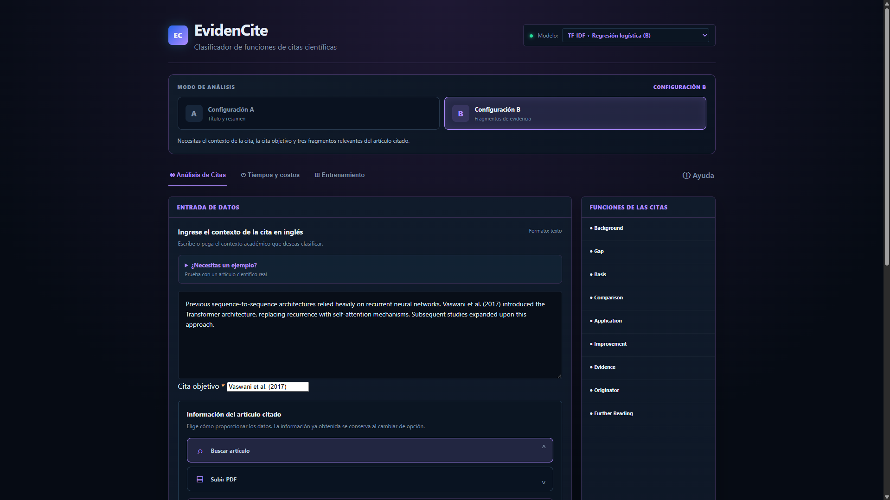
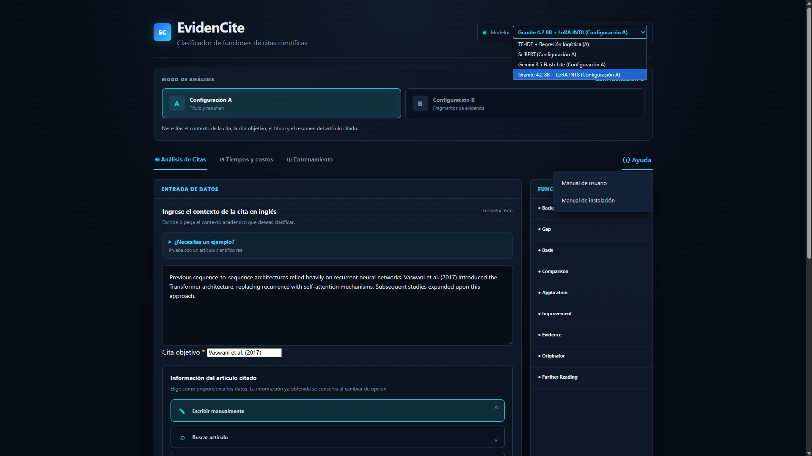
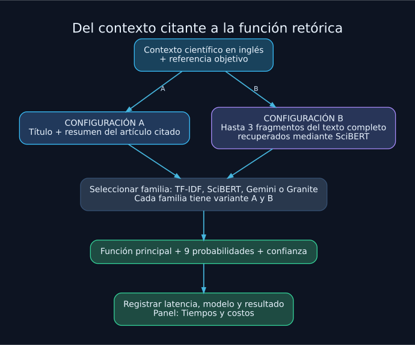
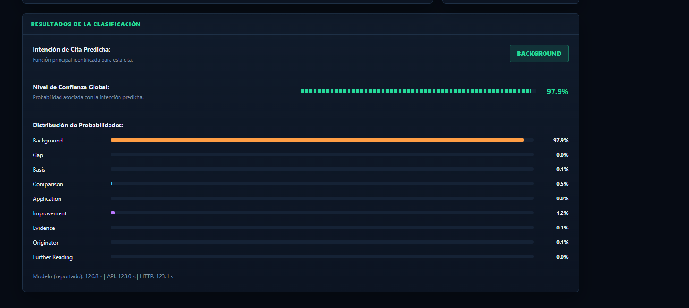
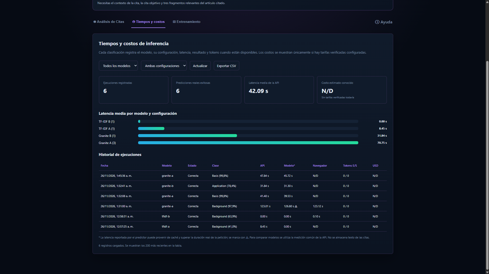
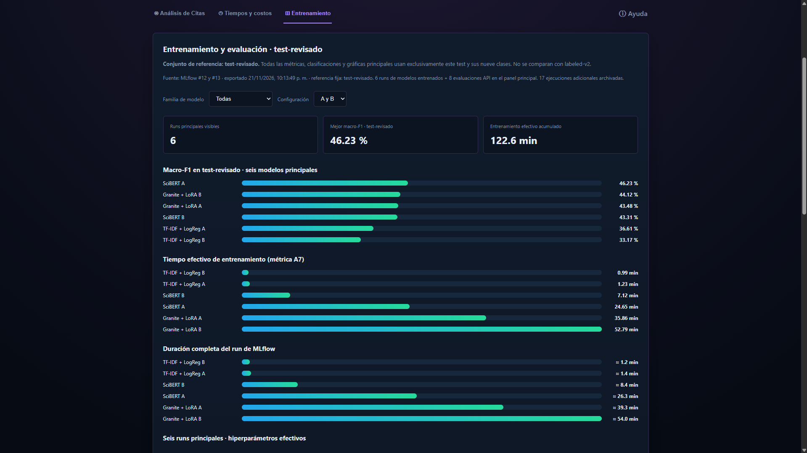
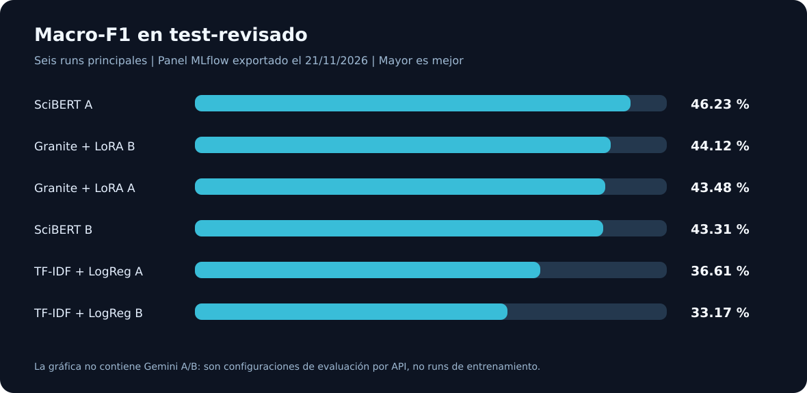

# Manual de usuario

**EvidenCite: clasificación de funciones retóricas de citas científicas**

[Aplicación en línea](https://evidencite.54-163-149-217.sslip.io) | [Repositorio GitHub](https://github.com/d-leandro/EvidenCite) | [Manual de instalación](manual-instalacion.html)

> **Versión del manual:** 26 de noviembre de 2026. Es una demostración académica; la URL se basa en la IP de una EC2 de AWS Academy y puede cambiar. Los modelos Granite A/B requieren que el trabajador externo del equipo esté encendido.

## 1. ¿Qué hace EvidenCite?

A partir de un **contexto citante en inglés** y la referencia que deseas analizar, EvidenCite predice una de las **nueve funciones retóricas** de la cita. Puedes comparar cuatro familias de modelos en dos configuraciones de evidencia, A y B, para un total de ocho clasificadores.

**EvidenCite no verifica la veracidad de un artículo ni reemplaza la evaluación de expertos.** La confianza y las probabilidades expresan el comportamiento matemático del modelo ante la entrada.

## 2. Conoce la interfaz



*Figura 1. Vista real de EvidenCite con Configuración B y contexto de ejemplo cargado.*

La interfaz se divide en cuatro áreas principales:

| Sección | Qué permite hacer |
|---|---|
| **Análisis de Citas** | Seleccionar A/B, elegir modelo, ingresar la cita y ejecutar la clasificación |
| **Tiempos y costos** | Consultar latencia, registros históricos, costos cuando se conocen y exportar CSV |
| **Entrenamiento** | Explorar las métricas y visualizaciones de los experimentos de referencia |
| **Ayuda** | Abrir este manual y el manual de instalación |



*Figura 2. Selector de modelo y accesos a los dos manuales desde la aplicación publicada.*

La lista de modelos refleja su estado actual. Si un servicio deja de estar disponible, podría desaparecer de las opciones seleccionables hasta que se recupere.

## 3. Flujo guiado en cinco pasos

1. **Preparar el ejemplo.** Abre [EvidenCite](https://evidencite.54-163-149-217.sslip.io), expande **¿Necesitas un ejemplo?** y pulsa **Cargar ejemplo**.
2. **Verificar la cita.** Debe aparecer el contexto ilustrativo sobre `Vaswani et al. (2017)` y la referencia objetivo correspondiente.
3. **Obtener el artículo citado.** Busca el ID arXiv `1706.03762` o el título *Attention Is All You Need*. Revisa y confirma los metadatos. Como alternativa, proporciona el artículo manualmente (A) o sube el PDF correspondiente.
4. **Elegir modo y modelo.** Para A, completa título y resumen. Para B, pulsa **Recuperar los 3 fragmentos** o utiliza la carga de PDF para preparar evidencia textual. Selecciona uno de los modelos disponibles.
5. **Clasificar e interpretar.** Pulsa **Clasificar intención de cita**. Observa la etiqueta principal, la confianza y la distribución entre las nueve clases.

### Texto de ejemplo

> Previous sequence-to-sequence architectures relied heavily on recurrent neural networks. Vaswani et al. (2017) introduced the Transformer architecture, replacing recurrence with self-attention mechanisms. Subsequent studies expanded upon this approach.

- **Cita objetivo:** `Vaswani et al. (2017)`.
- **Artículo citado:** *Attention Is All You Need*.
- **Identificador arXiv:** `1706.03762`.
- **Nota:** el texto es **ilustrativo y elaborado para el prototipo**, no fue extraído de una publicación citante real.

## 4. Configuraciones A y B



*Figura 3. Datos necesarios para A y B, y elección de familia de modelo.*

| | Configuración A | Configuración B |
|---|---|---|
| Contexto citante y cita objetivo | Sí | Sí |
| Evidencia del artículo citado | Título y resumen | Tres fragmentos relevantes de texto, con sus secciones cuando existan |
| Preparación desde la interfaz | Buscar artículo, ingresar manualmente o extraer metadatos del PDF | Confirmar artículo y recuperar fragmentos, o procesar PDF |
| Ventaja de uso | Rápida cuando existen metadatos | Puede aportar información local más específica |
| Consideración | Puede omitir detalles del texto completo | Requiere recuperar evidencia útil y del artículo correcto |

**A:** si faltan título y resumen, el formulario no estará listo para la clasificación. **B:** si faltan fragmentos, primero ejecuta la recuperación y verifica que pertenezcan al artículo citado. No cambies a B esperando que el título y resumen sean suficientes.

### Procesar un PDF

El formulario permite cargar un PDF del artículo citado de hasta **20 MB**. Antes de extraer datos, confirma que corresponde a la referencia objetivo, porque el sistema no puede verificar esa relación automáticamente. Un PDF escaneado o con estructura inusual puede producir una extracción incompleta. No envíes documentos restringidos o confidenciales sin autorización.

## 5. Seleccionar el clasificador

| Familia | Modelos disponibles | Descripción breve |
|---|---|---|
| TF-IDF y regresión logística | `tfidf-a`, `tfidf-b` | Modelo estadístico ligero para una línea base interpretable |
| SciBERT | `scibert-a`, `scibert-b` | Modelo especializado en textos científicos, ajustado para la clasificación |
| Gemini 3.5 Flash-Lite | `gemini-a`, `gemini-b` | Modelo de lenguaje consultado mediante API externa |
| Granite 4.2 8B + LoRA INT8 | `granite-a`, `granite-b` | Modelo ajustado con adaptadores LoRA, ejecutado en CPU en el PC del equipo |

**Granite está integrado de verdad.** La API de AWS invoca su servicio remoto por HTTPS y consulta el estado del trabajo hasta recibir el resultado. La inferencia puede tardar decenas de segundos o algunos minutos, según tamaño de la entrada y carga de CPU. No recargues la página innecesariamente.

## 6. Interpretación de las nueve clases

| Clase | Significado práctico |
|---|---|
| **Background** | La referencia aporta antecedentes o contexto general |
| **Gap** | Se describe una brecha, limitación o problema pendiente |
| **Basis** | La investigación citada fundamenta el enfoque actual |
| **Comparison** | Se comparan enfoques, resultados o metodologías |
| **Application** | Se utiliza directamente un recurso, herramienta o método citado |
| **Improvement** | Se modifica, extiende o mejora el trabajo citado |
| **Evidence** | La cita sustenta una afirmación con evidencia |
| **Originator** | Se reconoce a quien introdujo una idea o método |
| **Further Reading** | Se remite al lector a referencias para ampliar información |

La clase con mayor probabilidad determina la predicción principal. Es posible que distintas familias devuelvan etiquetas diferentes para la misma entrada. No se debe comparar la confianza de modelos distintos como si estuviera automáticamente calibrada.



*Figura 4. Ejemplo de resultado real de Granite A con etiqueta principal, confianza y probabilidades de las nueve clases. Corresponde a una entrada de demostración, no a una métrica de evaluación.*

## 7. Métricas de inferencia, tiempos y costos



*Figura 5. Ejecuciones reales, latencias por modelo y exportación CSV.*

El panel distingue **duración medida por la API**, **duración reportada por el predictor** y, cuando existe una medición desde el navegador, **duración observada por el usuario**. Estas cantidades pueden diferir por red, recuperación de datos, cola de Granite o caché. Un tiempo reportado por un predictor puede proceder de caché y no equivaler al tiempo de la petición actual; el panel indica esa condición.

La columna de costo muestra **N/D** cuando no existe una tarifa validada. No significa que el uso de API, EC2 o electricidad tenga costo cero.

Los registros de inferencia de la EC2 se guardan en un volumen local. **Pueden perderse si se destruye la instancia** sin respaldarlos antes.

## 8. Entrenamiento y evaluación experimental



*Figura 6. Panel de los seis runs principales de modelos entrenados y sus métricas.*



*Figura 7. Macro-F1 sobre el conjunto `test-revisado`, según el panel exportado de MLflow el 21 de noviembre de 2026.*

El panel muestra métricas de los modelos entrenados (TF-IDF, SciBERT y Granite, A/B), no un entrenamiento que se ejecute al hacer clic. Gemini A/B se evalúan como servicios externos y no están incluidos en esos seis runs. **No mezcles métricas de conjuntos de datos diferentes** al interpretar resultados.

## 9. Uso de la API (opcional)

```bash
APP_URL='https://evidencite.54-163-149-217.sslip.io'
curl -fsS "$APP_URL/health"
curl -fsS "$APP_URL/api/v1/models"
curl -fsS "$APP_URL/api/v1/labels"
```

Ejemplo de predicción TF-IDF A:

```bash
curl -fsS --max-time 180 "$APP_URL/api/v1/predict" \
  -H 'Content-Type: application/json' \
  --data '{
    "model_id":"tfidf-a",
    "citing_context":"Our approach builds on the Transformer architecture introduced by Vaswani et al. (2017), making attention central to the sequence processing method.",
    "target_citation":"Vaswani et al. (2017)",
    "cited_title":"Attention Is All You Need",
    "cited_abstract":"The Transformer is an architecture based entirely on attention, rather than recurrence and convolution."
  }'
```

Una respuesta correcta incluye `predicted_label`, `probabilities`, `confidence`, `model_name` y datos de medición. Para B se añaden `cited_chunks` y, opcionalmente, `cited_chunk_sections`. No se promete una etiqueta concreta para una entrada de prueba.

## 10. Solución de problemas

| Problema | Acción sugerida |
|---|---|
| El modelo no aparece | Recarga la página; consulta `/api/v1/models`. Puede haberse detenido un servicio externo |
| No puedes analizar en modo A | Completa la cita objetivo y el título/resumen del artículo |
| No puedes analizar en modo B | Primero recupera o proporciona fragmentos válidos |
| El artículo no aparece en la búsqueda | Busca por ID arXiv o título exacto y confirma el resultado |
| El PDF falla | Comprueba formato, límite de 20 MB y correspondencia con la cita |
| HTTP 429 | La aplicación limita consultas por IP; espera antes de repetir |
| Granite tarda más de lo esperado | Puede estar procesando otra predicción, cargando pesos o usando CPU intensivamente |
| Granite figura como no disponible | Comprueba disponibilidad del PC, Docker Desktop y Tailscale Funnel; informa al equipo |
| La URL no abre | La EC2 puede estar detenida o tener una IP pública nueva |
| La predicción parece incorrecta | Revisa contexto, referencia y evidencia; la salida es una estimación del modelo |

## 11. Alcances y privacidad

Este prototipo fue diseñado principalmente para textos científicos en inglés. No está destinado a decisiones de alto impacto ni a evaluación automática de calidad científica. La infraestructura tiene límites de cómputo, tasa y presupuesto; evita consultas automatizadas masivas. No cargues documentos confidenciales, datos personales innecesarios o textos para los que no tengas permiso.

[Volver al índice](index.html) | [Manual de instalación](manual-instalacion.html) | [Repositorio](https://github.com/d-leandro/EvidenCite)
