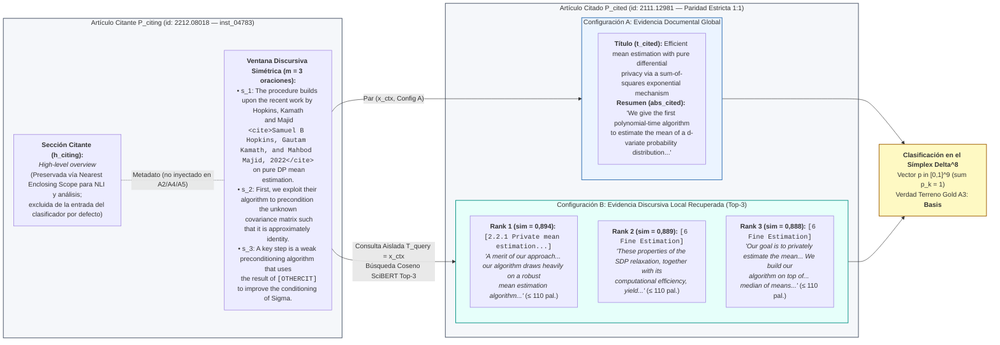
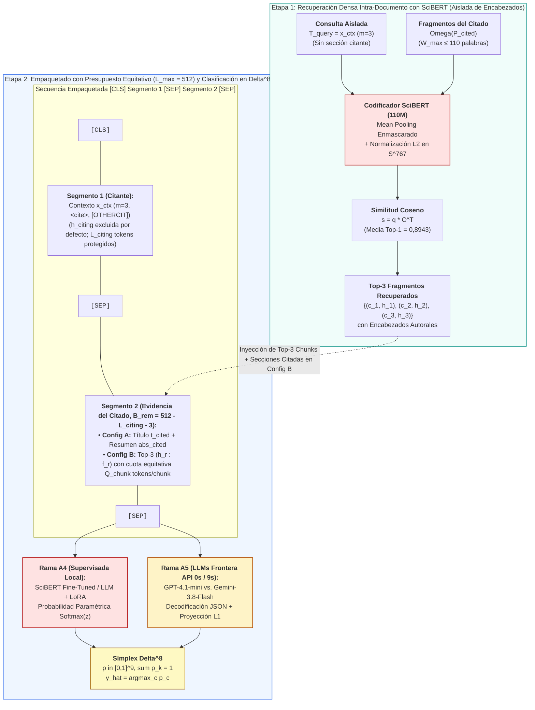
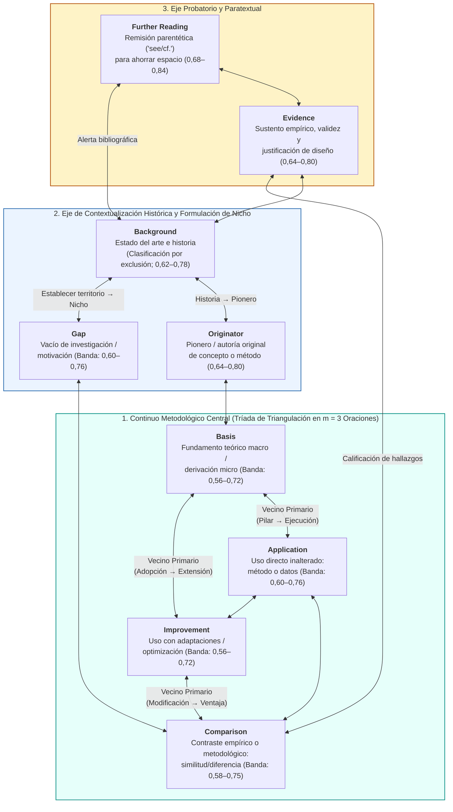
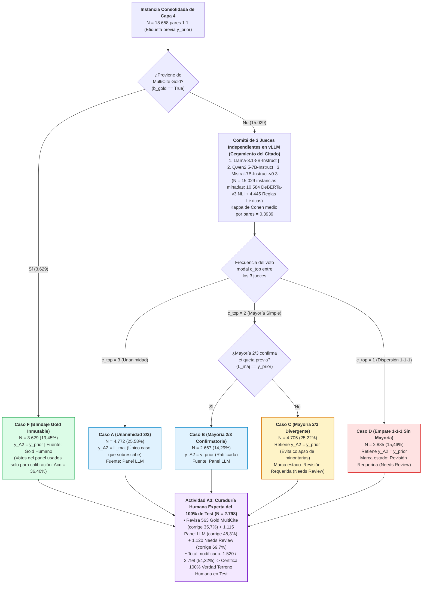
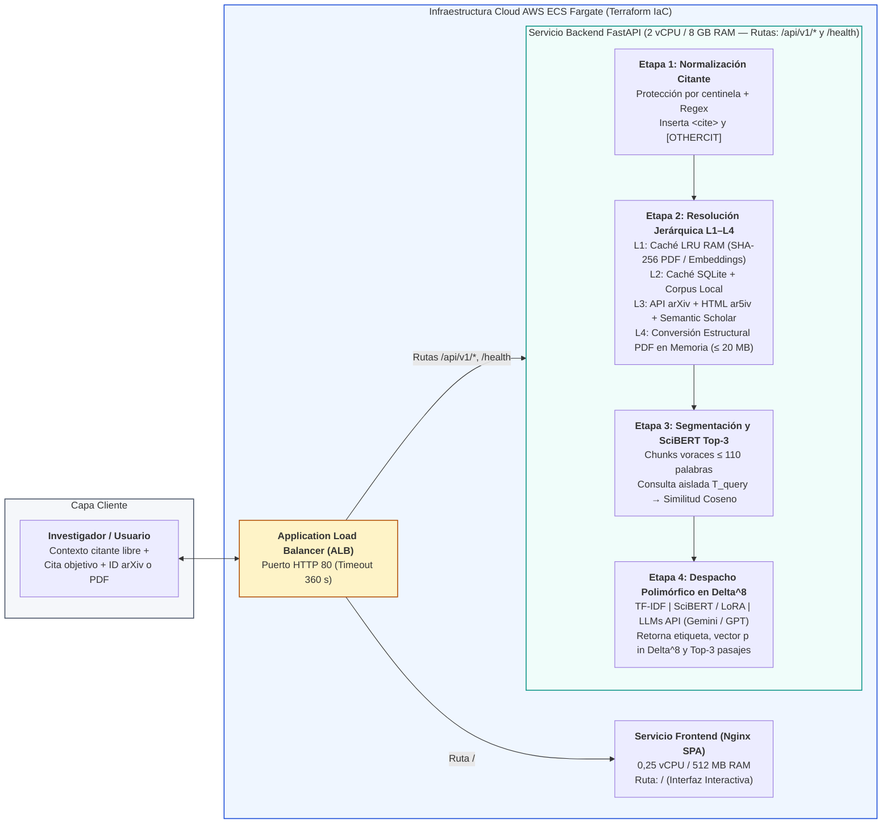

# Especificación Visual y Código Mermaid de Diagramas Arquitectónicos para Draw.io (`diagrams.net`)

**Proyecto de Grado MAIA — Universidad de los Andes**  
**Artículo:** *EvidenCite: Recomendación Local de Citas y Clasificación de su Función Retórica en Artículos Académicos mediante Recuperación Densa e Inferencia en el Símplex*  
**Autores:** Daniel Ricardo Gallo Acevedo, Dubán Leandro Jiménez Puerta, Julián Andrés Malaver Montoya y Javier Mauricio Torres Ortega  

---

## 1. Propósito de este Documento y Paleta Académica Unificada

Este anexo documenta la especificación visual exacta (geometría de nodos, códigos hexadecimales de relleno y borde, tipografía, estilo de conectores y bloques de código **Mermaid** listos para importar en `Arrange -> Insert -> Advanced -> Mermaid` en **Draw.io / diagrams.net**) de:
1. **Los 4 diagramas incluidos nativamente en TikZ dentro de `informe_final_ieee.tex`** (los 3 diagramas arquitectónicos principales —Figuras 1, 2 y 4— más el contrato JSON estructurado de la Figura 3).
2. **3 diagramas complementarios de alto valor científico** extraídos e inspirados en la lectura completa de **CiteFusion** (Paolini et al., *Scientometrics*, 2025), **MultiCite** (Lauscher et al., *NAACL*, 2022) y **Local Citation Recommendation with HAtten + SciBERT Reranking** (Gu et al., *ECIR*, 2022).

### Paleta de Colores Académica para Draw.io (Compatible con Impresión B/N y Escala de Grises)

| Rol Semántico del Componente | Color de Relleno (`fillColor`) | Color de Borde (`strokeColor`) | Color de Texto (`fontColor`) | Estilo en Draw.io |
| :--- | :---: | :---: | :---: | :--- |
| **Contenedor Documental (`Citante` / `Citado`)** | `#F5F7FA` | `#4A5568` | `#1A202C` | `rounded=1;arcSize=6;strokeWidth=1.5;` |
| **Configuración A (Evidencia Global: Título + Resumen)** | `#EBF4FF` | `#2B6CB0` | `#1A365D` | `rounded=1;arcSize=8;strokeWidth=1.5;` |
| **Configuración B (Evidencia Local: Top-3 Chunks + Sección)** | `#E6FFFA` | `#0D9488` | `#134E4A` | `rounded=1;arcSize=8;strokeWidth=1.5;` |
| **Codificador / Modelo Neuronal (`SciBERT` / `DeBERTa-v3`)** | `#FEE2E2` | `#B91C1C` | `#7F1D1D` | `rounded=1;arcSize=10;strokeWidth=1.5;` |
| **Motor de Inferencia / Jueces / LLMs Comerciales (A2 / A5)** | `#FEF3C7` | `#B45309` | `#78350F` | `rounded=1;arcSize=10;strokeWidth=1.5;` |
| **Marco Retórico / Contexto Citante ($m=3$, `<cite>`)** | `#F3E8FF` | `#6B21A8` | `#3B0764` | `rounded=0;strokeWidth=1.2;` |
| **Tokens Especiales (`[CLS]`, `[SEP]`) y Salida Símplex $\Delta^8$** | `#FEF9C3` | `#A16207` | `#422006` | `rounded=0;fontFamily=Courier New;fontStyle=1;` |
| **Almacén Persistente / Caché (`SQLite`, `JSONL`, `KV Cache`)** | `#E0F2FE` | `#0369A1` | `#0C4A6E` | `shape=cylinder3;size=10;strokeWidth=1.5;` |

---

## 2. Diagrama 1: Par Conceptual Citante–Citado y Contraste Configuración A vs. Configuración B

* **Correspondencia en `informe_final_ieee.tex`:** Figura 1 (`\label{fig:conceptual_citante_citado}`), Sección III-A.
* **Inspiración Bibliográfica:** Figura 1 de **CiteFusion** (Paolini et al., 2025, p. 5913; archivo `assets-informe-final/scitefusion-example-of-citing-paper-with-two-in-text-citations-referring-to-cited-papers.png`). Mientras CiteFusion ilustra un artículo citante apuntando a dos artículos citados mediante flechas de intención unidimensionales sin desglosar la estructura interna del artículo citado, nuestro diagrama extiende ese patrón visual para contrastar dentro del mismo artículo citado $\mathcal{P}_{\text{cited}}$ (bajo paridad estricta 1:1) la **Configuración A** (Título + Resumen global) frente a la **Configuración B** (Top-3 fragmentos locales $\le 110$ palabras con sus encabezados de sección vía *Nearest Enclosing Scope*).

### 2.1. Código Mermaid (Importable directamente en Draw.io)

### 2.2. Guía Paso a Paso para Transcripción Manual en Draw.io
1. **Lienzo y Rejilla:** Configurar página en orientación horizontal (`File -> Page Setup -> Landscape`, tamaño `8.5 in x 4.0 in`, rejilla de `10 pt`).
2. **Contenedor Izquierdo (`Artículo Citante`):** Insertar un rectángulo redondeado (`340 px x 240 px`, relleno `#F5F7FA`, borde `#4A5568`). En su interior, colocar una caja punteada gris arriba para el metadato `h_citing: High-level overview (usado en NLI y análisis; excluido en A2/A4/A5)` y una tarjeta blanca abajo con borde `#CBD5E1` que muestre la ventana discursiva de 3 oraciones ($s_1, s_2, s_3$, con desplazamiento al inicio de sección en `inst_04783`). Resaltar `<cite>Samuel B Hopkins, Gautam Kamath, and Mahbod Majid, 2022</cite>` con una píldora azul (`#DBEAFE`, borde `#1D4ED8`, fuente `Courier New Bold`) y `[OTHERCIT]` con píldoras grises (`#E2E8F0`).
3. **Contenedor Derecho (`Artículo Citado — Paridad 1:1`):** Insertar un rectángulo redondeado (`400 px x 240 px`, relleno `#F5F7FA`). Dividir su interior verticalmente en dos sub-cajas:
   - **Sub-caja superior (`Configuración A`):** Relleno azul tenue `#EBF4FF`, borde `#2B6CB0`, mostrando el título y resumen global.
   - **Sub-caja inferior (`Configuración B`):** Relleno verde azulado `#E6FFFA`, borde `#0D9488`, apilando tres tarjetas horizontales compactas para `Rank 1 (0,894)`, `Rank 2 (0,889)` y `Rank 3 (0,888)` con sus etiquetas de sección entre corchetes.
4. **Conectores:** Trazar una flecha azul (`#2B6CB0`, grosor `2 pt`) desde la ventana citante hacia la sub-caja de Configuración A y una flecha verde azulada (`#0D9488`, grosor `2 pt`) etiquetada con `Consulta Aislada T_query (SciBERT Top-3)` hacia la sub-caja de Configuración B.

---

## 3. Diagrama 2: Arquitectura Desacoplada en Cinco Capas del Pipeline de Datos y Etiquetado (A1–A3)

* **Correspondencia en `informe_final_ieee.tex`:** Figura 2 (`\label{fig:arquitectura_5_capas}`), Sección III-B (ancho completo `figure*`).
* **Inspiración Bibliográfica:** Figura 2 de **CiteFusion** (Paolini et al., 2025, p. 5923; archivo `assets-informe-final/citefusion-ensemble-architecture.png`). Se adopta el patrón de **banda superior de chevrones de proceso** (*process chevron banner*) alineada verticalmente con los bloques detallados de artefactos, motores de resolución y volúmenes verificados debajo de cada etapa.

### 3.1. Código Mermaid

```mermaid
flowchart LR
    subgraph L1["Capa 1: Ingesta Bruta (raw)"]
        direction TB
        R1["<b>MultiCite:</b> 11.251 citas Gold (7 clases)"]
        R2["<b>unarXive:</b> Volcados LaTeX CS (cs.*)"]
        R3[("<b>Caché Local SQLite + ar5iv/PDF:</b><br/>Consultas O(1) sin latencia de red")]
    end

    subgraph L2["Capa 2: Estructurada (structured)"]
        direction TB
        S1["<b>Resolución Seminal Dirigida:</b><br/>Top-250 MultiCite -> 146 validados -> 135 full-text"]
        S2["<b>Resolutor Jerárquico 2 Niveles:</b><br/>Nivel 1: HTML ar5iv | Nivel 2: Diseño PDF (≤ 20 pág.)"]
        S3["<b>Corpus Canónico (66.314 artículos):</b><br/>30.722 citados con cuerpo válido<br/>Preservación Nearest Enclosing Scope"]
        S1 --> S3
        S2 --> S3
    end

    subgraph L3["Capa 3: Procesada (processed)"]
        direction TB
        P1["<b>3a. Contextos Citantes (m = 3):</b><br/>179.114 preliminares -> <b>144.826 pares 1:1 válidos</b><br/>Media: 83,94 palabras | &lt;cite&gt; y [OTHERCIT]<br/>(3.629 Gold + 4.445 Reglas + 136.752 Pool)"]
        P2["<b>3b. Fragmentos Citados (Chunks):</b><br/>Acumulación oracional voraz W_max ≤ 110 pal.<br/>(~108 palabras, ~140 tokens WordPiece)"]
    end

    subgraph L4["Capa 4: Dataset Pareado 1:1 (dataset)"]
        direction TB
        D1["<b>Supervisión Débil NLI en Delta^8:</b><br/>DeBERTa-v3 (tau=0,6, conf ≥ 0,50, margin ≥ 0,15)<br/>63.802 / 135.035 aceptados (47,25%) -> 10.584 integrados"]
        D2["<b>Recuperación Densa Top-3:</b><br/>SciBERT Mean Pooling + L2 (sim Top-1 = 0,8943)"]
        D3["<b>Partición Agrupada Anti-Fuga (leakage = 0):</b><br/><b>N = 18.658 pares 1:1</b><br/>Train: 13.077 (5.835 art.) | Dev: 2.783 (1.243)<br/>Test: 2.798 (1.258 art.)"]
        D1 --> D3
        D2 --> D3
    end

    subgraph L5["Capa 5: Etiquetada y Validada (labeled)"]
        direction TB
        J1["<b>Auditoría A2 — Panel 3 Jueces (vLLM):</b><br/>Llama-3.1-8B, Qwen2.5-7B, Mistral-7B (kappa = 0,3939)<br/>Cegamiento del citado | Casos: A=4.772, B=2.667,<br/>C=4.705, D=2.885, F=3.629"]
        J2["<b>Curaduría Humana A3 (100% Test Gold):</b><br/>Revisión manual de N = 2.798 instancias<br/>1.520 etiquetas corregidas (54,32%)<br/>5.864 instancias Gold totales en el corpus"]
        J1 --> J2
    end

    L1 --> L2 --> L3 --> L4 --> L5

    style L1 fill:#F8FAFC,stroke:#64748B,stroke-width:1.5px
    style L2 fill:#EFF6FF,stroke:#2563EB,stroke-width:1.5px
    style L3 fill:#ECFEFF,stroke:#0891B2,stroke-width:1.5px
    style L4 fill:#F0FDFA,stroke:#0D9488,stroke-width:1.5px
    style L5 fill:#F0FDF4,stroke:#16A34A,stroke-width:1.5px
```

### 3.2. Guía Paso a Paso para Transcripción Manual en Draw.io
1. **Banda Superior de Chevrones:** Usar la forma `Step / Chevron` de la librería `General` de Draw.io (`180 px x 36 px` cada uno) para colocar en fila horizontal las 5 etapas (`Capa 1: Ingesta Bruta` $\to$ `Capa 2: Estructurada` $\to$ `Capa 3: Procesada` $\to$ `Capa 4: Dataset 1:1` $\to$ `Capa 5: Etiquetada`) con degradado progresivo de gris azulado a verde esmeralda.
2. **Columnas Verticales por Capa:** Debajo de cada chevron, alinear un contenedor vertical de `180 px x 220 px` con los sub-módulos internos y las cifras exactas de transición ($66.314$ artículos $\to 144.826$ candidatos 1:1 $\to 135.035$ evaluados por NLI con $47,25\%$ de aceptación $\to 18.658$ pares 1:1 con $\text{leakage}=0$ $\to 2.798$ Test Gold humano).

---

## 4. Diagrama 3: Pipeline en Dos Etapas de Recuperación Densa SciBERT + Empaquetado e Inferencia en $\Delta^8$ (A4/A5)

* **Correspondencia en `informe_final_ieee.tex`:** Figura 4 (`\label{fig:pipeline_dos_etapas}`), Sección III-C (ancho completo `figure*`).
* **Inspiración Bibliográfica:** Combinación directa de las Figuras 1 y 3 de **Gu et al. (ECIR 2022)** (`assets-informe-final/two-stage-local-citation-recommendation-pipeline.png` y `assets-informe-final/structure-of-scibert-reranker.png`). Se adapta la gramática visual de bloques de tokens coloreados con llaves inferiores (`\underbrace`) de la Figura 3 de Gu et al. para mostrar cómo EvidenCite generaliza el segundo segmento desde `Título + Resumen` (Configuración A) hacia los `Top-3 Fragmentos + Secciones Citadas` con cuota equitativa $Q_{\text{chunk}}$ (Configuración B).

### 4.1. Código Mermaid

### 4.2. Guía Paso a Paso para Transcripción Manual en Draw.io
1. **Panel Superior (`Etapa 1 — Prefetching / Recuperación Intra-Documento`):** Replicar el flujo izquierda a derecha de la Figura 1 de Gu et al. (2022): colocar `Consulta Aislada` (azul `#DBEAFE`) y `Fragmentos del Citado` (verde `#CCFBF1`) entrando al bloque rojo suave `SciBERT (Mean Pooling + L2)` (`#FEE2E2`), seguido de un vector vertical de 3 círculos negros (`16 px x 48 px`), el bloque amarillo `Producto Coseno Top-3` (`#FEF3C7`) y las 3 tarjetas superpuestas `Top-3 Chunks + Secciones`.
2. **Panel Inferior (`Etapa 2 — Cinta de Tokens y Clasificación`):** Replicar la cinta horizontal de bloques adyacentes de la Figura 3 de Gu et al. (2022):
   - `[CLS]` (`40 px x 36 px`, amarillo `#FEF08A`).
   - `Contexto Citante (m=3)` (`180 px x 36 px`, violeta `#F3E8FF`; `h_citing` excluida por defecto para simetría con MultiCite), agrupado debajo con una llave horizontal (`Shape -> Curly Bracket`) rotulada `Segmento 1: Discurso del Artículo Citante`.
   - `[SEP]` (`40 px x 36 px`, azul claro `#BAE6FD`).
   - `Evidencia del Citado (Config A ó Config B con cuota Q_chunk)` (`260 px x 36 px`, verde suave `#DCFCE7`), agrupada debajo con una segunda llave horizontal rotulada `Segmento 2: Evidencia del Artículo Citado (Presupuesto ≤ 512 tokens)`.
   - `[SEP]` (`40 px x 36 px`, azul claro `#BAE6FD`).
3. **Bifurcación Hacia el Símplex $\Delta^8$:** Desde el segundo `[SEP]`, bifurcar hacia la rama supervisada A4 (`SciBERT / LoRA -> Softmax`) y la rama generativa A5 (`GPT-4.1-mini / Gemini-3.8-Flash -> Esquema JSON + Proyección L1`), convergiendo en el nodo romboidal/redondeado `Símplex Delta^8`.

---

## 5. Diagramas Adicionales Recomendados (Inspirados en la Lectura Completa de `CiteFusion`, `MultiCite` y `Ref-03`)

A partir de la revisión integral de las referencias núcleo del proyecto, se diseñaron tres diagramas adicionales listos para emplear en la sustentación oral, póster científico o documentación extendida:

### 5.1. Diagrama Adicional 4: Topología de Triangulación Retórica y Vecindad en el Símplex $\Delta^8$

* **Inspiración Bibliográfica:** Inspirado en el mapa de calor de Información Mutua Puntual (PMI) de co-ocurrencia de etiquetas de **MultiCite** (Lauscher et al., 2022, Figura 2d, donde `Extends` y `Differences` exhiben el mayor acoplamiento pragmático), en las matrices de correlación de masa de atribución SHAP de **CiteFusion** (Paolini et al., 2025, Figura 9 y Tablas 11–13) y en la auditoría taxonómica de **Lyu et al. (2021)** sobre las nueve funciones retóricas no evaluativas.
* **Valor Científico:** Visualiza por qué las 9 clases canónicas no son vértices ortogonales aislados, sino que conforman tres ejes discursivos acoplados en ventanas de $m=3$ oraciones, explicando visualmente la Proposición de Co-Localización ($P_1 = (1 - \epsilon + \Delta)/2$) y la matriz de vecindad retórica de las demostraciones 9-Shot.

---

### 5.2. Diagrama Adicional 5: Árbol de Decisión del Protocolo Conservador del Panel de 3 Jueces Abiertos (A2) y Curaduría Humana (A3)

* **Inspiración Bibliográfica:** Inspirado en el flujo de adjudicación y control de calidad de anotadores de **MultiCite** (Lauscher et al., 2022, Sección 4.1) y en el árbol de verificación híbrida de modelos abiertos frente a modelos propietarios de **Fogelson et al. (2025, Figura 1)**.
* **Valor Científico:** Explica visualmente las 5 reglas de consenso conservador (Casos A, B, C, D y F) sobre las $18.658$ instancias, mostrando cómo se evita el colapso del $39\%\text{--}53\%$ en las clases minoritarias y cómo la curaduría humana A3 ($N=2.798$) audita y corrige el conjunto de prueba.

---

### 5.3. Diagrama Adicional 6: Arquitectura de Inferencia en Tiempo Real y Despliegue Cloud en AWS ECS Fargate (Actividad A8)

* **Inspiración Bibliográfica:** Inspirado en la arquitectura de aplicación práctica de producción de **CiteFusion** (Paolini et al., 2025, Sección 5.3, p. 5962) y en el análisis de latencia extremo a extremo de pre-recuperación + inferencia de **Gu et al. (2022, Sección 4.3, Tabla 4)**.
* **Valor Científico:** Documenta el flujo completo de 4 etapas en tiempo real para citas arbitrarias ingresadas por un usuario final y la topología de red aprovisionada mediante Terraform en AWS ECS Fargate.

---

## 6. Instrucciones Rápidas de Importación y Exportación en Draw.io (`diagrams.net`)

1. **Importación automática desde Mermaid:**
   - Abrir [app.diagrams.net](https://app.diagrams.net/).
   - En la barra superior, seleccionar **`Arrange` $\to$ `Insert` $\to$ `Advanced` $\to$ `Mermaid...`**.
   - Pegar cualquiera de los 6 bloques Mermaid anteriores y pulsar **`Insert`**. Draw.io generará automáticamente todos los contenedores, nodos editables, estilos hexadecimales y conectores ortogonales.
2. **Ajuste Tipográfico Estándar IEEE:**
   - Seleccionar todos los elementos (`Cmd+A` / `Ctrl+A`) y en la pestaña **`Text`** del panel derecho fijar la fuente en **`Helvetica`** o **`Times New Roman`** (`9 pt` para encabezados de contenedor, `8 pt` para texto de nodos, `Courier New 8 pt` para marcadores `<cite>`, `[OTHERCIT]`, `[CLS]`, `[SEP]`).
3. **Exportación Vectorial para LaTeX (`PDF` / `SVG`):**
   - Seleccionar **`File` $\to$ `Export as` $\to$ `PDF...`**, marcar las casillas **`Selection Only`** y **`Crop`** (con `Border Width = 2 pt`) para insertar directamente con `\includegraphics` sin márgenes blancos excedentes.
